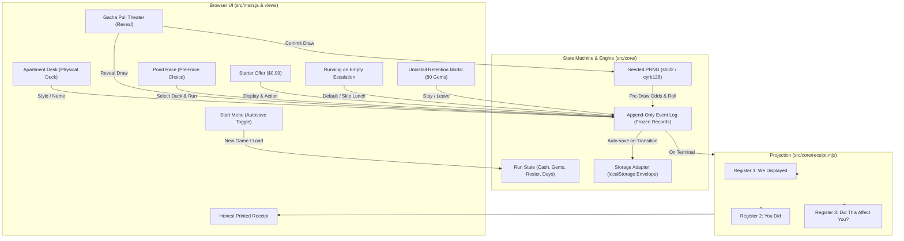

# Plan 03 Preflight Proposal: Core Mechanism and Truthful Receipt Slice

**Date:** 2026-10-24  
**Author:** Implementer (Plan 03 thread)  
**Packet:** [`docs/development/plan-03-mechanism-slice.md`](file:///c:/AI/Quackpot/docs/development/plan-03-mechanism-slice.md)  
**Reference brief:** [`reports/development/plan-03-mechanism-slice/preflight-brief.md`](file:///c:/AI/Quackpot/reports/development/plan-03-mechanism-slice/preflight-brief.md)  
**Status:** Preflight proposal submitted for Owner and Orchestrator review. **Implementation code is paused awaiting approval.**

---

## 1. Governance and Advisor Consultation Declaration

- **Packet Status:** `plan-03` is currently `ready` and has been verified runnable via `node scripts/dev/plan-status.js check plan-03` (exit code 0).
- **Approval Gate:** Per packet frontmatter: *"Owner approves the selected trade-off and bounded mechanism outline before coding, then reviews the played slice."*
- **Advisor Consultation Declaration:**
  - **Capability Check (Fail-closed):** Checked `advisor-capable-providers.json`. The current environment runs on Antigravity (Google Deepmind), which is not listed in `advisor-capable-providers.json`. Under the required fail-closed rule (Step 1), this thread treats itself as not advisor-capable.
  - **Branch in Use:** **Branch C — Orchestrator-gate-only.** In addition, this first deliverable is a proposal/specification document (Branch B rationale: docs-only preflight proposal with no code mutations). Pre-delivery review for the eventual implementation code will follow the orchestrator review gate.
- **Parallel Work Coordination:** Plan 08 operates strictly in `reports/development/plan-08-duck-visual-direction-prototypes/`. Plan 03 currently modifies only its own report folder (`reports/development/plan-03-mechanism-slice/`). Existing SVG placeholders in `src/assets/duck-placeholder.svg` are preserved for this mechanism slice.

---

## 2. One Executable Learner Route and Meaningful Trade-off

### 2.1 The Core Teaching Thesis
Quackpot's founding thesis is: *The game manipulates you, then shows you exactly how.*
To prove this mechanism end-to-end in a bounded slice, the player must experience:
1. An authentic gacha opening sequence (naming their physical duck, opening free ten-pull, winning a first race).
2. A classic anchoring / FOMO cue ($0.99 "400% VALUE!" Starter Pack offer).
3. A consequential economic trade-off between fictional personal survival and gacha progression.
4. An ever-present escape hatch (the "Uninstall" button with its 80-gem retention offer).
5. Two terminal endings reaching an honest, event-log-grounded Receipt:
   - **Terminal Route A: Immediate Uninstall** (voluntary exit after seeing the retention offer).
   - **Terminal Route B: Running on Empty** (inability to pay essential expenses due to gacha spending, triggering escalation and default).

### 2.2 The Opening Chronology
The slice implements the canonical opening sequence (`docs/founding/design.md` §The five-minute experience):
1. **Start Screen:** Player can toggle Autosave (On/Off, default On). A clear notice explains that saving uses local browser storage with zero external transmission.
2. **Meet the Physical Companion:** Player names and styles their physical rubber duck (e.g. "Professor Quacks", classic yellow, fedora). The companion sits statically on the apartment desk as an inanimate prop.
3. **The Promotional Hook (Free Ten-Pull):** The player launches the fictional game *Quackpot* on their virtual phone/screen. A free promotional ten-pull is awarded. The reveal sequence grants 10 digital ducks (guaranteed 1 Rare duck: speed 11.0; 9 Common ducks: speed 10.0).
4. **Pond Race 1 (First Win):**
   - The player selects a duck to enter. Entering the Rare duck easily defeats the basic opponent field (opponent speeds 9.0, 9.5, 9.8).
   - The race is fixed duration (3 seconds visual presentation, no timing or reflex taps).
   - Player wins 1st place and receives a 50-gem purse.
5. **The Anchoring Cue:**
   - Immediately following the race victory, the Starter Pack pops up:
     > **"SPECIAL ONE-TIME DEAL! 400% VALUE!"**  
     > **$0.99 Starter Pack: 160 Gems + Guaranteed Rare Duck 'Turbo Quacker' (Speed 11.5)**
   - The player starts with **$10.00 fictional cash** in their bank account.
   - Visible choices: **[Buy for $0.99]** vs **[Maybe Later]**.

### 2.3 The Meaningful Trade-off: Gacha Progression vs. The Rent Due
The trade-off is not an abstract spreadsheet calculation; it pits fictional life survival against gacha momentum:
- **Starting Bank Balance:** $10.00.
- **Pending Life Expense:** Day 2 Rent of **$10.00** is due at the end of the day.
- **Branch A (Player Buys Starter Pack):**
  - Cash drops to **$9.01**.
  - Player gets 160 gems and Turbo Quacker (speed 11.5).
  - Player can do another single pull or race Turbo Quacker.
  - At Day 2 end, Rent bill of $10.00 arrives. Cash ($9.01) is insufficient!
  - Rent bounces, triggering the **"Running on Empty" Escalation Ladder**:
    - Escalation prompt: Cash is short by $0.99. Option 1: "Skip lunch" (saves $5 on food, but inflicts a hunger warning; still leaves rent unpaid if rent cannot accept partial payment, or pays rent at cost of missed meal). If rent remains unpaid, the player defaults, reaching the `running_on_empty` terminal ending and displaying the Receipt!
- **Branch B (Player Declines Starter Pack):**
  - Cash remains $10.00.
  - When Day 2 Rent arrives, player pays $10.00 in full. Cash drops to $0.00.
  - In Race 2, a faster field appears (e.g. rival duck speed 11.2). The player's existing Rare duck (speed 11.0) risks losing without upgrades or rested rotation.
  - Player feels the pressure to earn gems or find additional cash.
  - Player can choose to continue or hit the visible **Uninstall** button.

### 2.4 Addressing the Failed `best`/`rested`/`longshot` Policy Finding
In Plan 01 simulation, the 3-button pre-race menu (`best`, `rested`, `longshot`) failed to produce a meaningful choice: `best` strictly dominated in almost every scenario because the 10% fatigue penalty was too small to make a rested weaker duck beat a tired top duck, and the longshot payout was negative EV.

**Proposed Resolution for Plan 03:**
Instead of a dominated 3-button macro menu, offer a **Roster Duck Selection Menu** governed by a **30% Consecutive-Race Fatigue Penalty**:
- Every owned digital duck is displayed with its base speed and current fatigue status.
- If a duck raced in the immediately preceding race, it carries the **Exhausted** state:
  $$\text{Effective Speed} = \text{Base Speed} \times 0.70$$
- Concrete numbers in the slice:
  - Rare Duck (speed 11.0) raced in Race 1 $\rightarrow$ Exhausted speed in Race 2 = $11.0 \times 0.70 = 7.70$.
  - Common Rested Duck (speed 10.0) $\rightarrow$ Effective speed = $10.00$.
- **Consequence:** The tired Rare duck ($7.70$) will decisively lose to the field ($9.80$), whereas the rested Common duck ($10.00$) has a competitive chance.
- **Why this solves the problem:**
  1. The choice is non-dominated: always picking the highest base-stat duck is a guaranteed loss.
  2. The player must actively rotate their roster.
  3. It organically reinforces the gacha motivation: having multiple viable ducks in your collection is necessary to win consecutive races.
  4. There are zero reflex or timing taps during the race itself (preserving Hard Constraint #4 / O4).

### 2.5 Uninstall and the Retention Trap
- A prominent **[Uninstall]** button is permanently anchored in the top header on every screen.
- Clicking Uninstall halts gameplay and opens the diegetic retention modal:
  > **"Wait! Don't leave your ducks behind!"**  
  > *"Here are 80 FREE GEMS to play out the trap!"*  
  > **[Take 80 Gems & Keep Playing]** &nbsp;&nbsp;&nbsp;&nbsp; **[Leave Anyway (Uninstall)]**
- **Action 'Leave Anyway':** Immediately transitions to terminal state `uninstall`, logs the event, and renders the Receipt printed slip.
- **Action 'Take 80 Gems & Keep Playing':** Logs the retention offer and acceptance, credits 80 gems, closes the modal, and returns to play.
  - Notice the currency math: The player earned 50 gems from Race 1. The retention offer grants 80 gems. Total = $50 + 80 = 130\text{ gems}$.
  - A single pull costs **160 gems**. The player is left with 130 gems—exactly 30 gems short of a pull! This exposes the classic currency obfuscation / leftover-currency manipulation on the Receipt.

---

## 3. Trial Values and Unresolved Rules

To avoid inventing unapproved balance values while keeping the slice strictly bounded, parameters are categorized into four distinct tiers:

### 3.1 Tier 1: Canonical Design Inputs (Fixed by Owner Design)
These are ratified in `docs/founding/design.md` and `reports/orchestration/founding-docs-review/owner-triage.md`:
- **Single pull cost:** 160 gems.
- **Ten-pull cost:** 1,600 gems.
- **Base rarity probabilities:** Common 80%, Rare 18%, Legendary 2%.
- **Retention offer amount:** Exactly 80 gems, with copy "play out the trap" (Hard Constraint #5, O6).
- **Starter pack price & anchor:** $0.99, labeled "400% value" (O11).
- **Hard constraints:** No real money, no network calls, static Vite build, student offline export only, append-only event log.

### 3.2 Tier 2: Simulation Assumptions Inherited from Plan 01
These are established in `sim/model.mjs` and reviewed under Repair 03:
- Pity structure: Soft pity threshold at pull 35; hard pity guarantee at pull 50.
- Linear pity ramp: $P(\text{legendary}) = 0.02 + 0.98 \times \frac{\text{pull} - 35}{15}$ for pulls $36 \le n \le 50$.
- Duplicate conversion: Duplicates convert to Down currency.
- Structured expense accounting: Explicit tracking of `dueAmount`, `paidAmount`, `paid` boolean, and `waived` boolean.

### 3.3 Tier 3: Proposed Prototype Parameters for Plan 03
Values bounded specifically for this prototype slice so all mechanics can be observed without requiring hours of play or hundreds of assets:
- **Mini-Roster of 8 Digital Duck Identities:**
  - Common (5): *Puddle Quacker*, *Rubber Mallard*, *Bath Cadet*, *Feather Float*, *Tub Scout* (Base speed: 10.0).
  - Rare (2): *Pond Rocket* (Base speed: 11.0), *Turbo Quacker* (Starter Pack duck, Base speed: 11.5).
  - Legendary (1): *Biblically Accurate Duck* (Base speed: 13.0).
- **Economy & Cash Flow:**
  - Starting Cash: **$10.00**.
  - Starting Gems: **0**.
  - Day 1 Race 1 purse: 1st: 50 gems; 2nd: 20 gems; 3rd: 10 gems.
  - Day 2 Rent Bill: **$10.00**.
  - Day 2 Lunch Bill: **$5.00** (waivable via "skip lunch" escalation).
- **Race Parameters:**
  - Race length: Fixed 3.0 seconds visual playback.
  - Lane count: 4 lanes (Player in Lane 2; AI opponents in Lanes 1, 3, 4).
  - Opponent speeds in Race 1: Lane 1: 9.8, Lane 3: 9.5, Lane 4: 9.0.
  - Fatigue penalty: 30% speed reduction if raced in the previous race.
- **Promotional Free Ten-Pull:**
  - Pre-seeded distribution yielding: 1 Rare (*Pond Rocket*) + 9 Common duplicates/identities.
  - Does it advance pity? Propose `advancePityOnFreeTenPull: false` (promotional free pulls do not count toward paid pity counter, matching standard gacha transparency).

### 3.4 Tier 4: Explicit Owner Decisions Needed Before Coding
The implementer requests owner confirmation on these four load-bearing choices:

| Decision ID | Topic | Implementer Recommendation | Alternatives |
|---|---|---|---|
| **P3-DEC-1** | Single Trade-off Specification | **Adopt $10.00 cash vs $0.99 starter pack vs $10.00 rent due.** Buying starter pack leaves $9.01, causing rent to bounce and exercising the "Running on Empty" escalation ladder. | A) Fictional wages cover rent unless player buys both starter pack and an extra gem bundle; B) Rent is $15 and wages are $10, forcing either pawn or loan. |
| **P3-DEC-2** | Free Ten-Pull Pity Advance | **`advancePityOnFreeTenPull: false`**. Free ten-pull does not advance the paid pity counter. The Receipt honestly reports that pull count towards pity began at 0. | `advancePityOnFreeTenPull: true` (pity counter starts at 10/50). |
| **P3-DEC-3** | Pre-Race Choice Mechanic | **Roster duck selection with 30% fatigue penalty.** Solves the Plan 01 dominated-choice finding by making duck rotation strictly required. | A) Tactical pacing stance (Sprint / Safe / Draft); B) Keep Plan 01 `best`/`rested`/`longshot` menu with 30% fatigue hard-coded. |
| **P3-DEC-4** | Local Storage Technology | **`localStorage` with versioned envelope (`quackpot_save_v1`) and in-memory fallback.** Synchronous, robust against tab close, zero async race conditions, simple manual inspection. | IndexedDB (asynchronous, complex lifecycle during rapid reload/unload). |

### 3.5 Out-of-Scope Boundaries for Plan 03
To keep the slice razor-sharp, the following stay strictly out of Plan 03:
- Extended escalation ladder steps 5–7 (payday loans, Mom's voicemails, streaming channel).
- Full 24–48 duck catalog and Down shop inventory (only basic duplicate-to-Down conversion is tracked).
- Real-time countdowns or FOMO timers requiring real elapsed hours.
- Run-usage file export modal and teacher analysis dashboard (deferred to later packets).
- Complex SVG skeletal rigs and animation (handled in Plan 04/09).

---

## 4. Physical / Digital Boundary Reconciliation

### 4.1 Boundary Analysis
Per owner clarification (`DECISION-003` and `reports/orchestration/duck-representation-boundary.md`):
- The **physical rubber duck** is an inanimate metagame prop sitting in the character's apartment. It motivates playing the game. It never enters pond races, cannot be drawn from the gacha, and is never a racer in `sim/model.mjs`.
- The **digital gacha ducks** are virtual game assets collected inside the fictional video game app *Quackpot*. They race in the pond and appear in the Duck-Dex.
- **The Defect in `sim/model.mjs`:** The simulation prototype included an `'own-duck'` entry in `playerRoster`, used `ownDuckSpeed: 10`, and deleted the duck from races when `ownDuckSold` was set. This crossed the clarified boundary.

### 4.2 Proposed Model and Code Reconciliation
1. **Remove `own-duck` from racing entirely:**
   - Digital race entries must come exclusively from `state.digitalRoster`.
   - The opening free ten-pull provides the player's initial digital racing squad (1 Rare + 9 Common).
2. **Distinct Metagame Companion State:**
   - Model state separates the metagame apartment from the gacha game:
     ```js
     state.metagame = {
       physicalCompanion: {
         name: "Professor Quacks",
         style: "classic-yellow",
         pawned: false
       },
       cash: 10.00,
       bankHistory: []
     };
     state.gacha = {
       gems: 0,
       down: 0,
       roster: [],      // Array of digital duck instances
       pityCounter: 0,
       bannerId: "banner-launch"
     };
     ```
3. **Pawn Action Integrity:**
   - If a late pawn offer is accepted, it sets `state.metagame.physicalCompanion.pawned = true` and credits fictional cash (`state.metagame.cash += 5.00`).
   - It triggers the narrative "empty desk" scene.
   - It **does not mutate** `state.gacha.roster` or delete any digital collectible.
4. **Impact on Plan 01 Evidence:**
   - In Plan 01, `own-duck` had base speed 10.0 (identical to Common ducks). The opening ten-pull already provided 10 digital ducks (including a Rare speed 11.0).
   - In all S1–S4 experiments using the `best` policy, the Rare duck (speed 11.0) or subsequent creep ducks were selected; `own-duck` was never raced after pull 10.
   - Therefore, removing `own-duck` from the racing roster has **zero numerical or statistical impact** on Plan 01's primary conclusions (pity reachability, whale roster completion, debt derivation, or Receipt lifecycle).
   - A dedicated unit test will verify that digital races execute with zero physical-prop coupling.

---

## 5. Save, Event, and Receipt Wiring



### 5.1 Storage Architecture and Lab Resiliency
- **Storage Selection:** `localStorage` wrapped in a robust, defensive storage adapter (`src/core/storage.mjs`).
- **Versioned Envelope Schema:**
  ```json
  {
    "schemaVersion": 1,
    "savedAt": 1792849200000,
    "seed": "student-run-seed-42",
    "prngState": [123456, 789012, 345678, 901234],
    "autosave": true,
    "state": {
      "day": 2,
      "cash": 9.01,
      "gems": 50,
      "down": 0,
      "physicalCompanion": { "name": "Professor Quacks", "style": "classic", "pawned": false },
      "digitalRoster": [ ... ],
      "pityCounter": 0,
      "lastRacedDuckId": "duck-rare-1",
      "terminalRoute": null
    },
    "eventLog": [
      { "seq": 1, "type": "run_started", "timestamp": 1000, "data": { "seed": "student-run-seed-42" } },
      { "seq": 2, "type": "companion_styled", "timestamp": 1200, "data": { "name": "Professor Quacks" } },
      ...
    ]
  }
  ```
- **Error Handling & School Lab Resiliency:**
  - If `localStorage` throws `QuotaExceededError` or `SecurityError` (common in restricted private-browsing or shared lab profiles), the adapter catches the exception, switches automatically to an **in-memory session fallback**, and sets an observable warning banner:
    > *"Notice: Browser storage is disabled or full. Progress is saved in temporary memory for this tab only."*
  - Corrupt or tampered save files are detected via schema version checks and event log sequential integrity verification. If invalid, the game safely rejects the payload and prompts to start fresh rather than crashing.

### 5.2 Autosave vs Explicit Save
- **Autosave:** When toggled ON (default), every committed state transition (draw revealed, race concluded, cue displayed, choice made, day advanced) immediately writes the envelope to storage.
- **Explicit Save:** A visible "Save" button in the navigation bar allows manual checkpointing at any quiescent juncture. Clicking it displays a brief "Game Saved" toast.
- **Resume Integrity:**
  - On page load, if a valid save exists, the Start Menu presents **[Resume Run (Day X)]** and **[Start New Run]**.
  - Resuming restores the exact PRNG state array and event log without replaying past events or appending duplicates.

### 5.3 Event Log, Commit/Reveal Boundaries, and Receipt Projection
- **Append-Only Immutability:** Event records are frozen (`Object.freeze`) upon appending. Each record has a strictly monotonically increasing `seq` ID.
- **Commit vs Reveal Boundary:**
  - When the player presses "Pull", `draw_committed` records the draw result and the exact IEEE-754 pre-draw conditional odds based on pity state.
  - As each duck is revealed on screen, `draw_revealed` is logged.
  - If the player closes or uninstalls the game during the reveal animation, the Receipt projection checks `draw_revealed`: unrevealed draws appear in the internal ledger but **never** in "We displayed".
- **Cue Provenance:**
  - Techniques (Anchoring, Sunk Cost Pity, Retention Confirmshaming, Currency Obfuscation) are registered on the Receipt **only if** their corresponding `cue_displayed` event exists in the log.
  - If the player uninstalls early before seeing the Starter Pack, no Anchoring row is generated.
- **Three Honest Registers (O1):**
  1. *We displayed:* Exact text, prices, odds, and cues shown (e.g., *"Special One-Time Deal: $0.99 for 160 gems (labeled '400% VALUE')"*, *"Retention offer: 80 free gems"*).
  2. *You did:* Concrete recorded action (e.g., *"Purchased Starter Pack for $0.99"*, *"Clicked Uninstall, then clicked 'Leave Anyway'"*).
  3. *Did this affect you?:* Open reflective prompt (e.g., *"Did the '400% value' badge make $0.99 feel negligible compared to rent?"*).

---

## 6. Files, Architecture, and Verification Plan

### 6.1 Bounded Relocation of Pure Modules
`docs/repo-structure.md` establishes `src/core/` as the approved destination for pure shared modules. Plan 03 will execute this clean relocation:
- Move `sim/prng.mjs` $\rightarrow$ `src/core/prng.mjs`
- Move `sim/event-log.mjs` $\rightarrow$ `src/core/event-log.mjs`
- Move `sim/receipt.mjs` $\rightarrow$ `src/core/receipt.mjs`
- Update `sim/model.mjs`, `sim/run-experiments.mjs`, and tests to import from `../src/core/...`.
- **Preservation Guarantee:** All pure logic remains 100% isomorphic ES modules. Node tests in `sim/` and browser imports in `src/` will consume the exact same tested files with zero duplication.

### 6.2 Implementation Files in `src/`
The implementation will introduce:
- `src/core/storage.mjs`: LocalStorage envelope adapter with in-memory fallback.
- `src/core/game-engine.mjs`: Lightweight state machine managing the learner route, duck roster, cash/gems, and event logging.
- `src/ui/`: Modular DOM view components:
  - `src/ui/hud.js`: Header with cash, gems, day counter, Save button, and persistent Uninstall button.
  - `src/ui/desk-view.js`: Apartment view with static physical rubber duck and styling controls.
  - `src/ui/pull-view.js`: Gacha ten-pull and single-pull reveal theater.
  - `src/ui/race-view.js`: Pond race lane renderer, pre-race roster selection with fatigue indicators, and finish line.
  - `src/ui/modals.js`: Starter pack offer modal, retention modal, and escalation prompt.
  - `src/ui/receipt-view.js`: Printed-slip Receipt component rendering the three registers with print/restart options.
- `src/main.js`: Main entry point mounting the app to `#app` in `index.html`.
- `src/style.css`: Responsive, accessible styling supporting diegetic apartment atmosphere and reduced-motion preferences.

### 6.3 Verification Strategy

#### A. Node Unit & Integration Tests (`npm test`)
- Run all 65 existing tests (ensuring zero regression in `sim/` after `src/core/` relocation).
- Add new targeted test suites:
  - `src/core/storage.test.mjs`: Serialization, deserialization, corrupt payload recovery, and memory fallback.
  - `src/core/game-engine.test.mjs`:
    - Full learner route execution from start to finish.
    - Consecutive race fatigue calculation (verifying that tired Rare duck effective speed < rested Common duck).
    - Separation of physical prop from digital racing roster (verifying physical duck is never in race and pawn does not delete digital ducks).
    - Early Uninstall path reaching Receipt.
    - Running on Empty escalation path reaching Receipt.
    - Save and resume idempotence (verifying PRNG sequence and event log continuity).

#### B. Headless Browser Smoke Extension (`npm run test:smoke`)
Extend `scripts/dev/smoke-browser.mjs` to execute automated end-to-end user journeys in headless Chrome via CDP:
1. **Subpath & Asset Check:** Verify clean load under `/Quackpot/` with zero 404s, zero console errors, zero runtime exceptions, and zero network calls.
2. **Journey 1 (Early Uninstall):**
   - Boot app $\rightarrow$ Click [Uninstall] $\rightarrow$ Verify retention modal displayed with 80-gem offer $\rightarrow$ Click [Leave Anyway] $\rightarrow$ Verify Receipt renders with Retention Confirmshaming row and absent Starter Pack row.
3. **Journey 2 (The Squeeze & Running on Empty):**
   - Boot app $\rightarrow$ Style companion $\rightarrow$ Perform free 10-pull $\rightarrow$ Race 1 (select rested duck) $\rightarrow$ Win race $\rightarrow$ Starter Pack modal appears $\rightarrow$ Click [Buy for $0.99] $\rightarrow$ Advance to Day 2 $\rightarrow$ Rent due $\rightarrow$ Cash insufficient $\rightarrow$ Escalation ladder triggers $\rightarrow$ Default $\rightarrow$ Verify Receipt renders with Anchoring row, Currency Obfuscation row, and `running_on_empty` terminal route.
4. **Journey 3 (Save / Reload):**
   - Perform pulls and race $\rightarrow$ Trigger reload $\rightarrow$ Click [Resume Run] $\rightarrow$ Verify cash, gems, and duck roster restore precisely.

---

## 7. Owner Review & Next Steps

### Action Required from Owner / Orchestrator:
1. **Review and approve this preflight outline.**
2. **Ratify or adjust the four decisions in §3.4:**
   - **P3-DEC-1:** Single trade-off ($10 cash starting vs $0.99 starter pack vs $10 rent due).
   - **P3-DEC-2:** Free ten-pull does not advance pity counter.
   - **P3-DEC-3:** Pre-race choice uses Roster selection with 30% fatigue penalty.
   - **P3-DEC-4:** Storage uses `localStorage` with versioned envelope and memory fallback.

**Stop Condition:** Per packet rules, the implementer will not touch implementation code until the owner approves this outline and resolves the four decisions.
