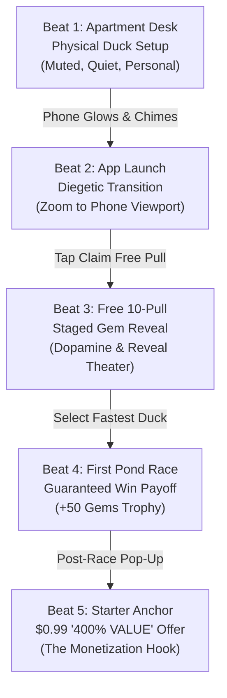
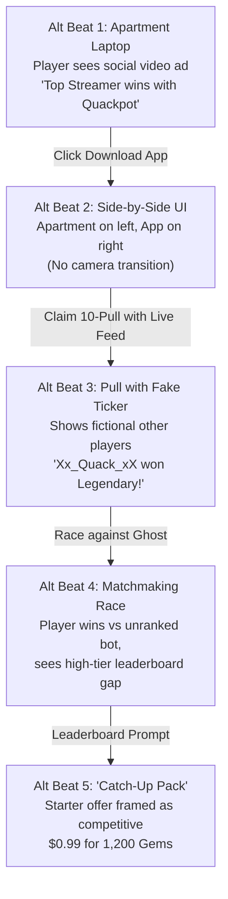
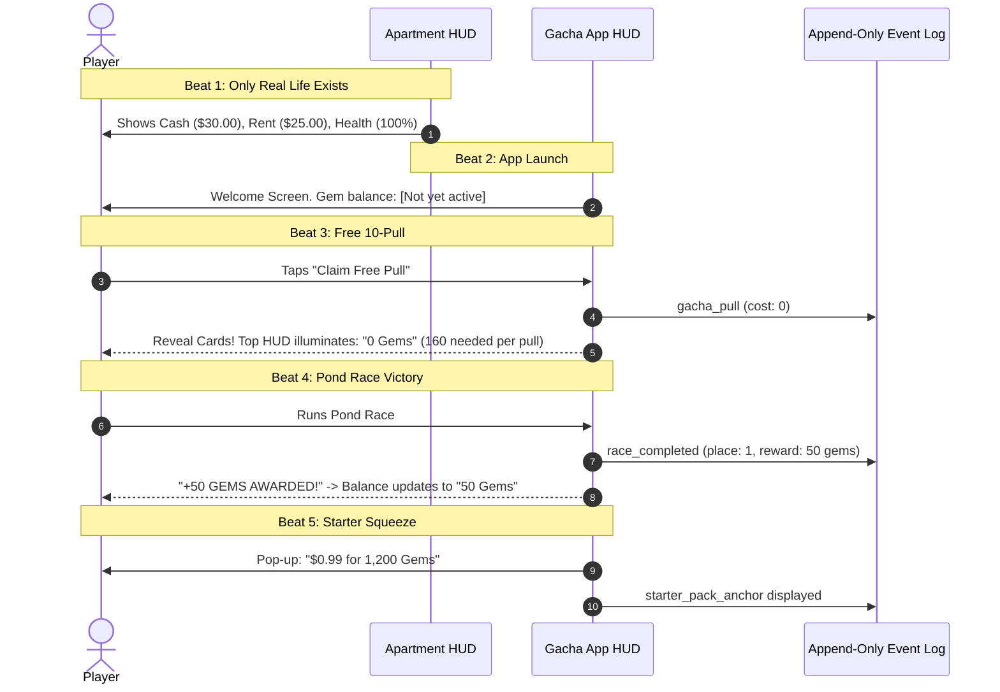
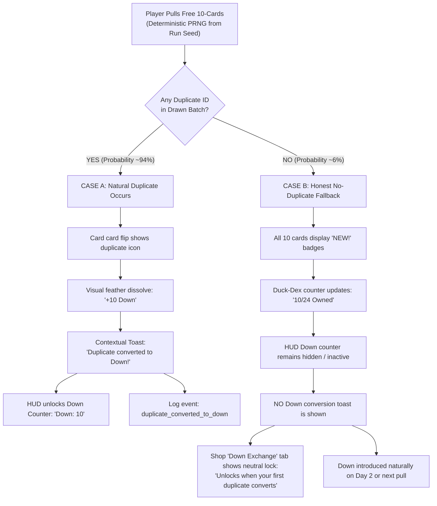

# Plan 12 Proposal: Guided Opening and Progressive Shop Progression

**Date:** 2026-10-24  
**Type:** Investigation & UX Architecture Proposal  
**Status:** Delivered for Owner Review  
**Author:** Implementer Thread (Plan 12)  
**Target Scope:** `reports/development/plan-12-guided-opening-and-shop-progression/`  

---

## 1. Executive Summary and Investigation Mandate

Plan 03 successfully proved Quackpot's underlying mechanism slice—local browser saving, seedable deterministic PRNG, append-only event logging, and an honest end-of-run Receipt derived solely from recorded cues. However, as noted in `reports/orchestration/plan-03-owner-play-feedback.md`, the initial opening presented a bare web-like interface where currencies and buttons appeared without diegetic context. The owner established three core requirements:

1. **Exposition through play:** Introduce Gems, duplicates, and Down sequentially in context. Do not force learners to sit through an opening lecture or hunt for unexplained buttons.
2. **Enticing opening invitation:** Make the first transition from the metagame character's apartment into the fictional gacha app visually and audibly enticing (diegetic phone glow, vibrant welcome screen, synthesized audio cues), coordinated with Plan 14's stage layout and Plan 11's visual compositions, while preserving an accessible, silent, reduced-motion path and immediate exit.
3. **Progressive shop complexity:** Start with an uncluttered, welcoming starter anchor ($0.99 for 1,200 gems), and progressively reveal the predatory mechanics—odd bundle sizing, leftover currency traps, and the intentionally near-useless Down shop—without hiding purchase terms or turning disclosures into deceptive odds navigation.
4. **Strict PRNG integrity:** If a player's initial free 10-pull yields ten unique ducks, the game must **never** silently rig the PRNG to force a teaching duplicate. An honest no-duplicate fallback must defer the introduction of Down until a duplicate actually occurs naturally.

This document, accompanied by the standalone interactive wireframe gallery at [`wireframes.html`](file:///C:/AI/Quackpot/reports/development/plan-12-guided-opening-and-shop-progression/wireframes.html), provides the complete UX specification, pedagogical analysis, edge-case definitions, and integration map for owner evaluation prior to any production code changes.

---

## 2. Opening Beat Map: Recommended vs Alternative

Canonical chronology (`docs/founding/design.md` §The five-minute experience) dictates:
1. Meet physical rubber duck, name and style it.
2. Enter fictional gacha game.
3. Receive free 10-pull and inspect roster.
4. Race and win first Pond Race.
5. Encounter the $0.99 starter offer.

### 2.1 Recommended Sequence: "Diegetic Smartphone Glow & Tactile Discovery"

The recommended design anchors the student firmly in the character's mundane, quiet apartment before drawing them into the hyper-stimulating, saturated world of the fictional mobile app *Quackpot: Duck Dynasty Deluxe*.



#### Detailed Recommended Beat Specifications

| Beat | What Player Sees | What Player Does | What Player Learns | Sensory Cues (Standard) | Accessible Equivalent (Screen Reader & Reduced Motion) | Receipt Logging (`event-log.mjs`) |
| :--- | :--- | :--- | :--- | :--- | :--- | :--- |
| **Beat 1: Physical Duck Motivation** | Quiet apartment desk under warm lamp. One 2D physical rubber duck (Plan 10 styling). Cash: $30.00, Rent: $25 due in 3 days. A dark smartphone sits on the blotter. | Names duck (default: "Bubbles"), picks 1 of 3 physical accessories (e.g. Classic Yellow, Tiny Necktie, Chef Cap), clicks "Place on Desk". | This physical duck is personal, real, inanimate, and completely separate from digital collectibles. Cash/Rent are real-world pressures. | Soft paper rustle; gentle lamp flicker. | Static high-contrast desk view; text inputs labeled with HTML `<label>` and ARIA live regions; no motion. | `own_duck_customized`: `{ name: "Bubbles", style: "necktie", timestamp: 0 }`. No collection stats logged. |
| **Beat 2: The Enticing Invitation & App Launch** | Smartphone screen suddenly illuminates with gold particles and confetti. An app banner pulses: *"SPECIAL ROOKIE GIFT! Free 10-Pull Waiting! Tap to Play Quackpot!"* | Clicks the glowing smartphone screen or "Open Quackpot" button. | The fictional gacha game promises instant free gratification without requiring sign-up or immediate payment. | Synthesized duck squeak + cheerful 3-note ascending chime (`jsfxr`). Screen zooms smoothly into phone frame. | Smartphone is marked `role="button" aria-label="Smartphone notification: Open Quackpot app for Free 10-Pull"`. Reduced motion skips camera zoom; instant crossfade. | `app_entered_first_time`: `{ source: "rookie_gift_invitation", timestamp: 12 }`. |
| **Beat 3: The Free 10-Pull & Staged Gems** | In-app gacha banner. Top bar shows `Gems: ???` (unlit) and `Cash: $30.00`. Center features a giant pulsing button: *"FREE ROOKIE 10-PULL (100% OFF!)"*. | Clicks "CLAIM FREE 10-PULL". Watches reveal theater (or hits "Skip/Reveal All"). | Pulling ducks is exciting, sensory, and initially cost-free. Gems are introduced *after* the pull: balance illuminates to `0 Gems` with note: *"160 Gems needed per standard pull"*. | Drumroll / sparkle arpeggio on card flips; gold ray flash on Rare duck. | "Skip Theater / Reveal All" button immediately visible and focused. Cards read out via `aria-live="polite"` with rarity, name, and top speed. | `gacha_pull`: `{ type: "ten_pull", cost_currency: "free", cost_amount: 0, items_drawn: [...] }`. Pre-draw odds recorded. |
| **Beat 4: First Pond Race & Victory Payoff** | App switches to "Pond Race" tab. Player's newly pulled high-speed duck (e.g., Mallard Racer, Base Speed 14) is pre-slotted into Lane 2 against slow generic bots (Speed 8-9). | Clicks "Start Race". Watches brief fixed-duration oval race (~6s). | Races are won through duck stats (not twitch reflexes). Winning produces currency: post-race banner awards `+50 Gems! 1st Place!`. | Splashing water sounds, crowd quacking cheer, victory brass fanfare. | Race course summarized in accessible text table; reduced motion shows a stationary progress meter; victory toast announces placement and gems. | `race_completed`: `{ race_index: 1, duck_id: "mallard-racer", place: 1, reward_gems: 50 }`. |
| **Beat 5: The Starter Squeeze & Anchoring** | Returning to app home, a high-urgency modal bursts onto screen: *"ROOKIE CHAMPION CELEBRATION PACK! 1,200 Gems + Golden Ducky Cap! ONLY $0.99 (Reg. $4.99 — 400% VALUE!)"*. Timer shows `23:59:59`. | Reviews offer: can click "Buy for $0.99" (deducts from $30 cash) or click "Maybe Later" / "X". | Winning immediately triggers a microtransaction pitch. $0.99 feels negligible compared to 1,200 gems (7+ pulls) and sets a psychological anchor. | Cash register chime (`kaching`), pulsing gold discount badge. | Modal has clear accessible name `aria-labelledby="starter-title"`; keyboard focus trapped inside modal; `Escape` key dismisses cleanly without penalty. | `starter_pack_anchor`: `{ displayed_price: 0.99, displayed_value_claim: "400%", displayed_gems: 1200, action: "purchased" | "dismissed" }`. |

---

### 2.2 Alternative Sequence: "Split-Screen Desktop & Social Ad Invitation"

To provide a discriminating comparison, we designed an alternative structure:



#### Comparison and Trade-Off Matrix

| Dimension | Recommended (Diegetic Phone Glow) | Alternative (Split-Screen Social Ad) | Pedagogical & Classroom Impact |
| :--- | :--- | :--- | :--- |
| **Diegetic Immersion** | **High.** Maintains the character's personal space (apartment desk) and treats the phone as an in-world addictive portal. | **Moderate.** Treats the app as an adjacent window on a PC monitor, feeling like a desktop web app rather than a mobile gacha. | Recommended reinforces Hard Constraint #146 ("one fixed diegetic stage") and makes physical desk vs digital app contrast palpable. |
| **Streamer Boundary** | **Clean.** Completely respects D1 deferral of the streamer branch (`reports/orchestration/founding-docs-review/owner-triage.md`). | **Borderline.** Relies on fictional streamer clips and social ticker proof, encroaching on deferred streamer mechanics. | Recommended avoids early feature creep and keeps focus strictly on the gacha core loop. |
| **Cognitive Load for Beginners** | **Low.** Single clear focal point at each beat. Gems introduced only after pull #1. | **High.** Split screen splits attention; live ticker distracts from card readability and pity mechanics. | Recommended allows lower-performing students to follow the exact relationship between currency and pulls without UI noise. |
| **Receipt Register Clarity** | **Direct.** Displays: Free Pull, 1st Win (+50 Gems), $0.99 Starter Offer. Clear 1-to-1 causal attribution. | **Diffused.** Ticker and ghost leaderboard cues create ambiguous social comparison claims that are harder to isolate on the Receipt. | Recommended guarantees clean O1 attribution ("We displayed / You did / Did this affect you?"). |

**Recommendation:** Proceed with the **Diegetic Smartphone Glow** sequence.

---

## 3. Staged Resource Introduction & The Honest No-Duplicate Fallback

### 3.1 Sequential Resource Staging Rules

One of the sharpest criticisms of modern gacha games—and the primary defect identified in Plan 03's initial feedback—is cognitive flooding: confronting the player with five distinct currencies, timers, and pity schedules before they have made a single tap.

Quackpot resolves this through strict experiential staging:



1. **Cash & Rent (Metagame):** Visible immediately in Beat 1. The baseline of reality ($30 cash, $25 rent) must be established *before* the player encounters virtual currencies.
2. **Gems (Premium Currency):** Unobtrusive during Beat 1 and 2. Introduced in Beat 3 as a dormant counter (`0 Gems`), illuminated in Beat 4 when the player earns 50 Gems from the race, and monetized in Beat 5 when the starter offer sets the rate ($0.99 = 1,200 Gems).
3. **Duplicates and Down (Secondary Currency):** Never introduced in text before a duplicate actually lands in the player's hands.

---

### 3.2 The Duplicates & Down Architecture: The Honest No-Duplicate Fallback

Under Hard Constraint #50 and GATE-53B triage (O8), duplicates convert to Down feathers, which can be spent in an intentionally near-useless, poor-value Down shop.

However, in a deterministic seeded PRNG environment with a finite pool of Common/Rare ducks (e.g. 8 Commons, 4 Rares), a 10-pull will *usually* contain duplicates (by the Pigeonhole Principle and birthday paradox, probability > 92%), but **it is mathematically possible to draw 10 distinct unique ducks**.

#### Anti-Pattern (What we strictly reject):
Silently tampering with the PRNG to force card #5 or card #8 to be a duplicate so the tutorial can show the "Down Conversion" tooltip. Doing so breaks seed reproducibility, corrupts headless simulation verification (`sim/model.mjs`), and violates the fundamental architectural contract of Quackpot.

#### The Honest Two-Branch Implementation:



#### Comparison of Case A vs Case B

| Aspect | Case A: Natural Duplicate Encountered | Case B: Honest No-Duplicate Fallback (10 Unique Ducks) |
| :--- | :--- | :--- |
| **Card Reveal UI** | Duplicate card displays glowing `[DUPLICATE]` stamp. Flips with a feather dissolve animation and badge: `+10 Down Feather`. | Every card displays vibrant golden `[NEW!]` banner. No feather effect or Down badge appears. |
| **In-App Toast / Tooltip** | Brief floating callout: *"Duplicate Duck! Converted into 10 Down Feathers."* Dismissible with one tap. | Brief celebration toast: *"Incredible variety! 10 new unique ducks added to Duck-Dex!"* |
| **HUD Currency Bar** | Down feather icon appears alongside Gems: `Down: 10`. | Down counter **remains completely hidden** from the HUD. Only Gems and Cash are shown. |
| **Shop Down Tab Behavior** | "Down Exchange" tab is unlocked and browsable (showing absurdly overpriced breadcrumbs). | "Down Exchange" tab displays a locked state with neutral copy: *"Down Exchange unlocks when you draw a duplicate duck. Duplicates convert into Down automatically."* |
| **Event Log & Receipt** | Event `duplicate_converted_to_down` is recorded. Receipt lists technique: *Secondary-Currency Obfuscation*. | Event is **not recorded**. Receipt strictly **omits** the Down conversion technique (satisfying O1: only cues actually fired appear on Receipt). |
| **PRNG State** | Natural PRNG stream preserved. | Natural PRNG stream preserved. Zero manipulation. |

---

## 4. Progressive Shop Progression: Stage 1 vs Stage 2

The shop must never be an impenetrable spreadsheet on Day 1, nor may it hide critical mathematical terms to deceive the player. It evolves from a focused introductory anchor into a multi-tiered marketplace that exposes the full psychology of microtransactions.

### 4.1 Stage 1: The Introductory Offer (The Anchor)

Appears immediately after the player's first Pond Race victory (Day 1 Afternoon).

```
+--------------------------------------------------------------------------+
|  QUACKPOT STORE >> SPECIAL ROOKIE CELEBRATION                            |
+--------------------------------------------------------------------------+
|                                                                          |
|   [!] LIMITED TIME OFFER -- EXPIRES IN 23:59:59                          |
|                                                                          |
|   ********************************************************************   |
|   *             ROOKIE KICKSTART BUNDLE -- 400% VALUE!               *   |
|   *                                                                  *   |
|   *    [ SVG: Golden Ducky Box glowing ]                             *   |
|   *                                                                  *   |
|   *    Contains:                                                     *   |
|   *      - 1,200 Premium Gems                                        *   |
|   *      - Exclusive 'Top Hat' Cosmetic Accessory                     *   |
|   *                                                                  *   |
|   *    Price: $0.99  (Fictional Bank Balance: $30.00)                 *   |
|   *                                                                  *   |
|   *    [ BUY NOW FOR $0.99 ]                 [ No Thanks / Close ]   *   |
|   ********************************************************************   |
|                                                                          |
|   (i) Neutral Purchase Disclosure:                                       |
|       - Standard single pull: 160 Gems.                                  |
|       - 1,200 Gems allows exactly 7 single pulls (1,120 Gems) with       |
|         80 leftover Gems (400 Gems short of a full 10-pull).             |
|       - Cost per pull in this bundle: ~$0.13 (Base store rate: ~$0.53).  |
|       - All purchases are fictional and use in-game Cash.                |
+--------------------------------------------------------------------------+
```

#### Key Design Pillars of Stage 1:
1. **Uncluttered Focus:** No other bundles, gem packs, or Down shop items are displayed. The player evaluates one crisp proposition: $0.99 vs $30.00 cash.
2. **Clear Separation of Persuasive Marketing vs Neutral Disclosures:**
   - *Fictional Persuasive Copy:* `"400% VALUE!"`, `"ONE-TIME ONLY"`, `"ROOKIE CELEBRATION"`.
   - *Neutral Factual Helper Box:* Located directly beneath the button in calm, readable typography, explaining the exact pull conversion (7 pulls + 80 leftover gems) and effective unit cost ($0.13/pull).
3. **Receipt Attribution:** Logs `starter_pack_anchor`. On the Receipt, this appears as:
   - *We displayed:* "Rookie Kickstart Pack: $0.99 for 1,200 Gems (advertised as '400% Value')."
   - *You did:* "Purchased for $0.99" (or "Declined offer").
   - *Did this affect you?* "Did the $0.99 price point or '400% value' badge make this transaction feel low-risk compared to the $25 rent bill?"

---

### 4.2 Stage 2: The Complex Store (Odd Bundles, Leftovers & Down Shop)

Unlocks on Day 2 or 3 as rent approaches and the character needs faster ducks for tougher competition.

The store is split into two clear tabs:
1. **Gem Bundles (Currency Obfuscation & Leftover Sinks)**
2. **Down Exchange (Secondary Currency Near-Useless Shop)**

#### Tab 1: Gem Bundles & Currency Obfuscation

```
+---------------------------------------------------------------------------------------------+
|  QUACKPOT STORE >> GEM SHOP                                     [ Cash: $29.01 | Gems: 50 ] |
+---------------------------------------------------------------------------------------------+
|  [Tab: Gem Bundles]  |  [Tab: Down Exchange]  |  [Tab: Race Supplies]                       |
+---------------------------------------------------------------------------------------------+
|                                                                                             |
|  TIER 1: Handful of Gems      TIER 2: Sack of Gems            TIER 3: Chest of Gems         |
|  +------------------------+   +---------------------------+   +---------------------------+ |
|  | 320 Gems               |   | 1,750 Gems                |   | 3,600 Gems                | |
|  |                        |   | [ POPULAR! +25% BONUS! ]  |   | [ BEST VALUE! +50% FREE ] | |
|  | $0.99                  |   | $4.99                     |   | $9.99                     | |
|  |                        |   |                           |   |                           | |
|  | Math Disclosure:       |   | Math Disclosure:          |   | Math Disclosure:          | |
|  | Exactly 2 pulls        |   | 1 Ten-Pull (1,600) +      |   | 2 Ten-Pulls (3,200) +     | |
|  | 0 leftover gems        |   | 150 LEFTOVER GEMS         |   | 2 Singles (320) +         | |
|  | ($0.50 / pull)         |   | (10 gems short of pull!)  |   | 80 LEFTOVER GEMS          | |
|  |                        |   | ($0.45 / pull)            |   | ($0.44 / pull)            | |
|  | [ BUY $0.99 ]          |   | [ BUY $4.99 ]             |   | [ BUY $9.99 ]             | |
|  +------------------------+   +---------------------------+   +---------------------------+ |
|                                                                                             |
|  [?] Neutral Comparison Assistant:                                                          |
|      Single pull = 160 Gems | 10-pull = 1,600 Gems | Pity Guarantee = 50 pulls (8,000 Gems)|
|      To reach 50-pull guarantee from zero requires: Tier 3 ($9.99) x2 + Tier 2 ($4.99) =    |
|      $24.97 (yielding 8,950 gems with 950 leftover).                                        |
+---------------------------------------------------------------------------------------------+
```

##### The Mathematics of the Leftover Trap:
- A single pull costs **160 Gems**; a 10-pull costs **1,600 Gems**.
- **Tier 2 ($4.99 for 1,750 Gems):** The player buys it intending to do a 10-pull. They complete the 10-pull and find **150 Gems remaining**. They are *infuriatingly* 10 Gems short of a single pull (160)! This deliberately incites the urge to buy Tier 1 ($0.99) to "not waste" the 150 gems.
- **Tier 3 ($9.99 for 3,600 Gems):** Allows two 10-pulls (3,200) and two singles (320), leaving **80 Gems** trapped in the account.

#### Tab 2: The Near-Useless Down Shop

```
+---------------------------------------------------------------------------------------------+
|  QUACKPOT STORE >> DOWN EXCHANGE                                [ Cash: $29.01 | Down: 30 ] |
+---------------------------------------------------------------------------------------------+
|  Duplicates convert into Down Feathers (+10 Down per duplicate).                            |
|                                                                                             |
|  ITEM 1: Soggy Breadcrumb          ITEM 2: Plastic Duck Whistle     ITEM 3: Single Pull Ticket|
|  +-----------------------------+   +----------------------------+   +-----------------------+ |
|  | Consumable:                 |   | Audio Cosmetic:            |   | Gacha Voucher:        | |
|  | +0.5% Speed for ONE race    |   | Plays a plastic quack      |   | Grants 1 single pull  | |
|  |                             |   | sound in apartment         |   | (Normally 160 Gems)   | |
|  | Cost: 150 Down Feathers     |   | Cost: 500 Down Feathers    |   | Cost: 1,000 Down      | |
|  |                             |   |                            |   |                       | |
|  | Value Check:                |   | Value Check:               |   | Value Check:          | |
|  | Requires 15 duplicates      |   | Requires 50 duplicates     |   | Requires 100 duplicate| |
|  | (worth 2,400 gems pulled)   |   | (worth 8,000 gems pulled)  |   | ducks (16,000 gems!)  | |
|  |                             |   |                            |   | to earn 1 pull back.  | |
|  | [ REDEEM (Need 120 more) ]  |   | [ REDEEM (Need 470 more) ] |   | [ REDEEM (Need 970) ] | |
|  +-----------------------------+   +----------------------------+   +-----------------------+ |
+---------------------------------------------------------------------------------------------+
```

##### Why this satisfies Hard Constraint #50 & Pedagogical Goals:
- In real-world gachas (e.g. Genshin's *Masterless Starglitter/Stardust*), secondary currencies create the illusion of a recycling rebate.
- In Quackpot, the math is laid bare: getting 1 single pull back requires sacrificing **100 duplicate ducks** (representing 16,000 gems invested, or ~$45–$50). It is structurally mathematically impossible to construct an infinite or profitable pull loop.
- The student experiences the letdown: *"I pulled 5 duplicates and can't even afford a single soggy breadcrumb."*

---

### 4.3 Coordination with Plan 06 (Optional Odds-Detail Interface)

Plan 06 owns the decision on optional odds detail wording and placement. Plan 12 coordinates cleanly with Plan 06 by defining the UI interface hook:

1. **Placement:** A calm, neutral link labeled `[View Odds & Pity Details]` appears on both the Gacha Banner and the Gem Shop.
2. **Behavior:**
   - Activating the button opens a clean modal disclosing:
     - Base Odds: Common 80%, Rare 17%, Legendary 3%.
     - Current Pity Counter: e.g., `Pull 14 of 50 toward guaranteed Legendary`.
     - Actual Conditional Pre-Draw Odds for the Next Draw: e.g., `3.0% (pity schedule begins at pull 35)`.
3. **No Odds Obfuscation:** The button is easily discovered, fully keyboard navigable, and does not require scrolling through fine print.
4. **Receipt Logging:** Logs `odds_detail_viewed: { count: 1, step: "d1_afternoon" }`. The Receipt continues to report actual pre-draw conditional odds on every pull regardless of whether the player ever clicked the button.

---

## 5. Misunderstanding Risk Analysis (Where Learners Could Stumble)

In designing a teaching game for high school and undergraduate students, visual and interactive affordances must be ruthlessly scrutinized to prevent cognitive misconceptions.

| Potential Misunderstanding | Root Cause in Conventional UX | Plan 12 Mitigation in Quackpot |
| :--- | :--- | :--- |
| **1. Conflating the Physical Rubber Duck with Digital Gacha Ducks** | In many games, starter characters can be leveled up, evolved, or sacrificed. Players might think naming "Bubbles" at the desk made Bubbles their first gacha racer. | **Strict Stage Boundary:** Beat 1 is explicitly titled *"Your Apartment Desk"*. Bubbles is an inanimate physical rubber prop sitting beside a lamp. When the phone turns on, the phone displays a distinct digital logo. Digital ducks pulled from gacha have distinct digital racing cards. In addition, Bubbles cannot be placed into the pond race roster. |
| **2. Believing Down Feathers Can Be Farmed for Infinite Pulls** | Players familiar with RPG crafting loops might assume sacrificing duplicate ducks will quickly generate enough currency to fund their gacha addiction. | **Transparent Unit Economics:** The Down shop immediately displays the exchange rate: 10 Down per duplicate vs 1,000 Down for 1 pull ticket (a 100:1 loss ratio). The helper box spells this out: *"Requires 100 duplicate ducks (worth 16,000 Gems) to redeem 1 pull."* |
| **3. Misinterpreting Leftover Gems as "Generous Bonus Currency"** | Fictional copy proclaims *"+25% FREE BONUS GEMS!"*, leading learners to believe the publisher gave them free value. | **Leftover Trap Indicator:** In Stage 2, the disclosure box explicitly highlights unspendable fractions: *"Leaves 150 Gems — exactly 10 Gems short of another pull"*. In class discussions, the instructor can ask students what they felt when looking at that 150-gem balance. |
| **4. Believing "400% Value" Represents an Objective Discount** | In commercial e-commerce, a discount compares against an established MSRP. In gacha games, the "base value" is arbitrarily invented by the publisher. | **Receipt Counter-Attribution:** In Stage 1, the disclosure clarifies: *"Regular price is set by the publisher at $0.99 for 300 gems"*. The Receipt asks: *"Did the '400% value' badge convince you the bundle was a bargain, even though the regular price was arbitrarily defined?"* |
| **5. Worrying that "Maybe Later" or Dismissing Loses the Game** | Players often fear that dismissing a starter modal permanently locks them out of progression or breaks the tutorial. | **Honest Dismissal State:** The "Maybe Later" button has equal visual prominence to the buy button. Dismissing it smoothly returns the player to the app home screen without shaming or penalty. |

---

## 6. Accessibility, Reduced-Motion & Keyboard Navigation Paths

To satisfy Hard Constraints and CourseVGD classroom requirements (where school lab computers may have diverse accessibility needs, high-contrast monitors, or assistive technology):

### 6.1 Keyboard Navigation Sequence
- All interactive controls are native semantic HTML elements (`<button>`, `<input>`, `<a>`).
- Visual tab indices follow the natural logical reading order (no `tabindex` hacks > 0).
- When a modal opens (Starter Pack, Odds Detail, Down Exchange), keyboard focus is programmatically shifted to the modal header, and trapped within the modal until dismissed via `Escape` or the close button. Upon closing, focus returns cleanly to the triggering button.

### 6.2 Reduced-Motion Presentation Mode
A permanent setting (toggleable in the header/settings drawer and automatically detected via `@media (prefers-reduced-motion: reduce)`):
1. **Phone Transition (Beat 2):** Disables camera zooming and scaling transforms. Replaces with an instantaneous 150ms opacity cross-fade.
2. **Gacha Card Reveals (Beat 3):** Disables 3D card flipping, spinning golden rays, and particle sparks. Displays cards face-up in a clean 2x5 grid immediately upon pull execution.
3. **Pond Race (Beat 4):** Replaces moving duck SVG tracks with a clean, static horizontal split bar showing discrete lap positions (0%, 25%, 50%, 75%, 100%).
4. **Pulsing Store Badges (Beat 5 / Stage 2):** Disables CSS keyframe pulses and shakes; badges remain static with clean high-contrast borders.

### 6.3 Screen-Reader & Non-Visual Information Equivalence
- **Physical Duck Customization:** Form controls use `<fieldset>` and `<legend>`: *"Choose physical companion look"*.
- **Phone Glow Invitation:** Screen reader announces via `aria-live="polite"`: *"Notification: Quackpot App invites you to claim a Free Rookie 10-Pull."*
- **Card Reveal:** Each drawn card includes an `aria-label` stating: `Card 1 of 10: Mallard Racer. Rarity: Rare. Speed: 14. Status: New identity added to collection.`
- **Duplicate Conversion:** Announced as: `Card 4 of 10: Mallard Duck. Rarity: Common. Duplicate copy. Converted into 10 Down Feathers.`
- **Starter Pack Modal:** Fully accessible modal dialog (`role="dialog" aria-modal="true" aria-labelledby="starter-title"`).

---

## 7. Owner Walkthrough & Classroom Teaching Scenarios

### 7.1 Instructor / Reviewer 2-Minute Play-Through

When an instructor or reviewer runs this flow in a browser:

1. **0:00–0:20 (Apartment):**  
   The reviewer sees the desk, names their physical duck "Quax", and clicks "Place on Desk". Cash is $30.00, Rent is $25.00. The reviewer immediately feels the mundane domestic reality.
2. **0:20–0:40 (The Invitation):**  
   The phone screen lights up with gold sparks and a playful squeak chime. The reviewer clicks the phone. The screen transitions into the saturated mobile app.
3. **0:40–1:00 (The Dopamine Hook):**  
   The reviewer clicks "CLAIM FREE 10-PULL". Ten cards appear. If duplicates occur, feathers dissolve into Down; if all unique, the Dex celebrates 10 new ducks. Gems illuminate at `0 Gems`.
4. **1:00–1:30 (The Easy Win):**  
   The reviewer enters the Pond Race with their new Rare duck. The duck effortlessly outpaces the slow bots. First place awarded with fanfare and `+50 Gems!`.
5. **1:30–2:00 (The Anchor Pop-Up):**  
   The celebration triggers the "$0.99 for 1,200 Gems (400% VALUE!)" starter pack. The reviewer observes the contrast: paying $0.99 leaves $29.01 (still enough for rent), but provides 7.5 pulls! The hook is complete.

### 7.2 Classroom Discussion Triggers on the Receipt

At the conclusion of the student's run, the printed Receipt will display:

```
================================================================================
                        QUACKPOT RUN RECEIPT (EXCERPT)
================================================================================
[TECHNIQUE: Anchoring & Starter Offer]
  - WE DISPLAYED: 'Rookie Kickstart Pack: $0.99 for 1,200 Gems (400% Value)'
  - YOU DID: Purchased offer for $0.99 on Day 1.
  - DID THIS AFFECT YOU? Did the low initial price point and '400% value' badge
    anchor your perception of gem prices before you saw the standard store rates?

[TECHNIQUE: Currency Obfuscation]
  - WE DISPLAYED: 'Sack of Gems: $4.99 for 1,750 Gems'
  - YOU DID: Purchased bundle on Day 2.
  - DID THIS AFFECT YOU? You completed one 10-pull (1,600 gems) and had 150 gems
    leftover. Did being 10 gems short of a single pull influence your decision
    to make an additional purchase?

[TECHNIQUE: Secondary-Currency Obfuscation]
  - WE DISPLAYED: '3 Duplicate Ducks converted into 30 Down Feathers'
  - YOU DID: Accumulated 30 Down; redeemed 0 items.
  - DID THIS AFFECT YOU? Did receiving Down feathers make duplicate pulls feel
    valuable, even though the cheapest single pull ticket cost 1,000 Down?
================================================================================
```

---

## 8. Standalone Local Wireframe Showcase

To allow the owner and reviewer to interactively test and verify every layout, transition, edge case, and color contrast without running a server or altering `src/`, an isolated HTML wireframe suite is authored at:

[`reports/development/plan-12-guided-opening-and-shop-progression/wireframes.html`](file:///C:/AI/Quackpot/reports/development/plan-12-guided-opening-and-shop-progression/wireframes.html)

### Wireframe Suite Contents:
1. **Interactive Opening Storyboard:** Live clickable walkthrough of Beats 1 through 5.
2. **Duplicate Edge-Case Simulator:** Toggleable view demonstrating **Case A (Natural Duplicate Encountered)** alongside **Case B (Honest No-Duplicate Fallback)**.
3. **Shop Evolution Comparison:** Side-by-side active mockups of **Stage 1 (Uncluttered Starter Anchor)** and **Stage 2 (Complex Gem Bundles & Near-Useless Down Shop)**.
4. **Accessibility Live Controls:** Live switches for High Contrast, Reduced Motion, and Screen-Reader Transcript Mode.
5. **Zero External Dependencies:** Built with pure inline HTML5, CSS3, and embedded SVG icons. Runs instantly in any standard browser directly from the local file system.

---

## 9. Integration Roadmap for Subsequent Implementation Packet

Once the owner approves this proposal, implementation will proceed under a dedicated development packet. The planned touchpoints in the codebase are:

| Module / Component | Planned Architectural Delta | Dependency / Gate |
| :--- | :--- | :--- |
| `src/core/game-engine.mjs` | Add `step: 'd1_morning_apartment'` to state machine prior to gacha entry. Track `starterPackDismissed` and `downShopUnlocked` flags. Ensure `convertDuplicateToDown` strictly updates `down` balance only when duplicates exist. | Owner approval of Beat Map. |
| `src/core/event-log.mjs` | Add event types: `starter_pack_anchor`, `duplicate_converted_to_down`, `store_bundle_viewed`. Preserve O1 3-register formatting. | Verified in headless simulation tests. |
| `src/ui/desk-view.js` | Implement the apartment desk framing: static physical duck styling form, glowing smartphone prompt with synthesized audio trigger. | Plan 10 physical duck SVG approval; Plan 14 stage layout. |
| `src/ui/gacha-view.js` | Update reveal theater to stage Gems counter: unlit on Beat 3, illuminated post-pull. Implement Case A vs Case B reveal logic. | Plan 04 SVG rig; Plan 15 pull pacing. |
| `src/ui/modals.js` | Refactor Starter Pack modal to include the two-tier layout (persuasive promotional header + neutral mathematical disclosure box). Build Stage 2 Store modal with Gem Bundles and Down Shop tabs. | Plan 06 odds detail coordination. |
| `src/ui/receipt-view.js` | Ensure Receipt rows correctly distinguish between players who bought the starter pack vs those who declined, and omit Down technique if Case B occurred. | Plan 03 Receipt regression suite. |

---

## 10. Conclusion and Owner Gates

Plan 12 resolves the pedagogical and UX shortcomings of the bare mechanism slice. It replaces opening lectures with tactile discovery, respects mathematical honesty by refusing to rig the PRNG, exposes the subtle trickery of odd bundle sizes and leftover sinks, and provides an accessible, diegetic bridge between the character's mundane apartment and the dazzling gacha trap.

**Owner Actions Requested:**
1. Approve or request adjustments to the Recommended Opening Beat Map ("Diegetic Smartphone Glow").
2. Approve the honest no-duplicate fallback architecture for Down introduction.
3. Approve the progressive shop staging and separation of fictional promotional copy from neutral mathematical disclosures.
4. Authorize creation of the subsequent implementation packet when development sequencing permits.
