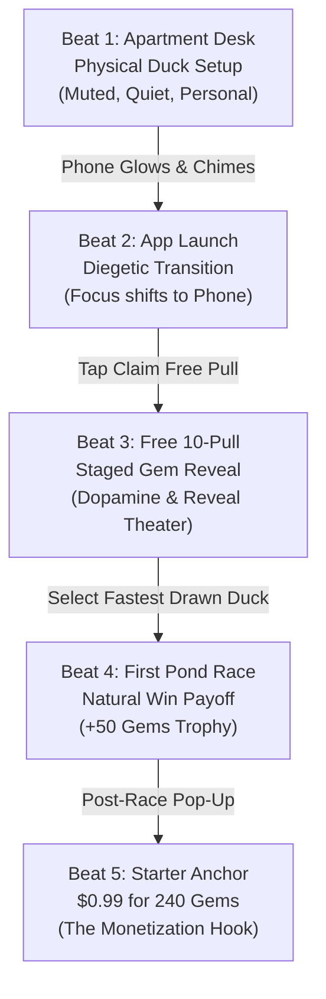
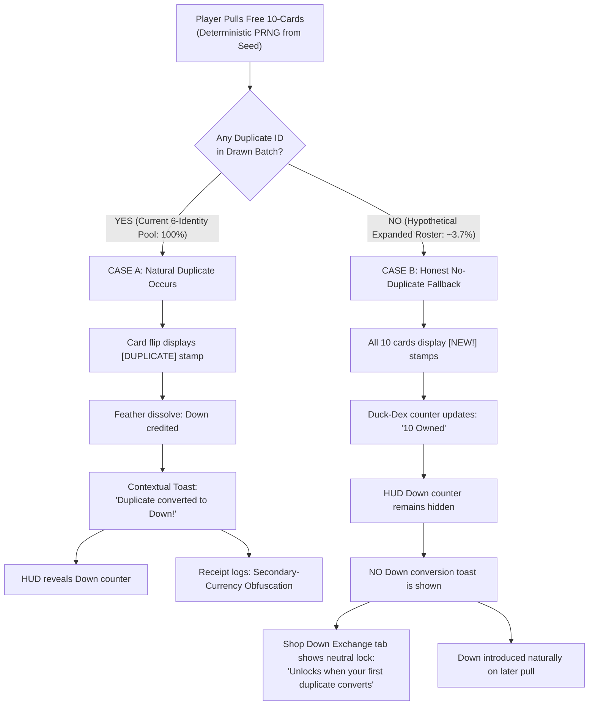

# Plan 12 Proposal: Guided Opening and Progressive Shop Progression (Repair 01)

**Date:** 2026-10-24  
**Type:** Investigation & UX Architecture Proposal  
**Status:** Delivered for Owner Review (Repair 01)  
**Author:** Implementer Thread (Plan 12)  
**Scope:** `reports/development/plan-12-guided-opening-and-shop-progression/`  

---

## 1. Executive Summary and Investigation Mandate

Plan 03 proved the core mechanics of Quackpot—local browser saving, seedable deterministic PRNG, append-only event logging, and an honest end-of-run Receipt derived solely from recorded cues. As established in [`reports/orchestration/plan-03-owner-play-feedback.md`](file:///C:/AI/Quackpot/reports/orchestration/plan-03-owner-play-feedback.md), the initial proof presented a bare website layout where currencies, buttons, and rules appeared without diegetic context. The owner directed:

1. **Exposition through play:** Introduce Gems, duplicates, and Down sequentially in context. Do not force learners to sit through an opening lecture or hunt for unexplained buttons.
2. **Enticing opening invitation:** Make the first transition from the metagame character's apartment into the fictional gacha app visually enticing (diegetic phone glow, vibrant welcome screen, synthesized audio cues), coordinated with Plan 14's stage layout and Plan 11's visual compositions, while retaining an accessible, silent, reduced-motion path and immediate exit.
3. **Progressive shop complexity:** Start with an uncluttered, welcoming starter anchor ($0.99 for 240 gems in the accepted trial), and progressively reveal predatory mechanics—odd bundle sizing, leftover currency traps, and the intentionally near-useless Down shop—without withholding purchase terms or turning disclosures into deceptive odds navigation.
4. **Honest PRNG integrity:** Never silently rig the PRNG to force a teaching duplicate. Defer Down introduction until a duplicate actually occurs naturally.
5. **Repair 01 Discipline:** This proposal uses Plan 03's approved trial constants as its primary reference baseline, clearly isolates unadopted future shop proposals, removes invented governance citations and subtitles, corrects roster mathematics, coordinates cleanly with Plan 06, and labels all wireframe artifacts and Receipt samples as illustrative mockups.

---

## 2. Reference Configuration vs. Unadopted Future Proposals

To ensure mathematical and architectural consistency, all values across this proposal and its accompanying wireframes distinguish between the **Plan 03 Accepted Trial Baseline** and **Illustrative Future Proposals**:

| Parameter | Plan 03 Accepted Trial Baseline (Reference) | Illustrative Future Proposal (Unadopted) | Status & Governance |
| :--- | :--- | :--- | :--- |
| **Game Title** | *Quackpot* | Fictional store banners may use satirical event labels | Canonical name is *Quackpot* (Hard Constraint #6; no unapproved branded subtitle). |
| **Starting Cash** | **$15.00** | — | Accepted Plan 03 trial constant (`GAME_CONSTANTS.START_CASH`). |
| **Starting Health** | **100%** | — | Accepted Plan 03 trial constant. |
| **Day-2 Rent Bill** | **$15.00** (due Day 2 afternoon) | — | Accepted Plan 03 trial constant (`RENT_DAY2`). |
| **Daily Wage / Food** | **+$10.00** wage / **-$5.00** food | — | Accepted Plan 03 trial constants. |
| **Pull Cost** | **160 Gems** (single) / **1,600 Gems** (ten-pull) | — | Provisional founding design constants (§Core loop). |
| **Base Draw Odds** | **Common 80.0%, Rare 18.0%, Legendary 2.0%** | — | Accepted Plan 03 trial model (`calculatePreDrawOdds`). |
| **Roster Pool** | **6 Identities** (`duck-0` to `duck-5`: 3 Common, 2 Rare, 1 Legendary) | Expanded roster ($\ge 10$ identities) | Current trial pool is 6 identities. Larger rosters remain future content waves. |
| **Down Conversion** | Common: 1 Down, Rare: 5 Down, Legendary: 20 Down | Uniform flat conversion (e.g. 10 Down/dup) | Accepted Plan 03 trial constant (`DOWN_PER_DUPLICATE`). |
| **Starter Pack Offer** | **$0.99 for 240 Gems** (gems-only, no cosmetic accessory) | $0.99 for 1,200 Gems + cosmetic cap | Trial starter is $0.99/240 gems. Larger bundles remain unadopted proposals. |
| **Starter Timer** | No artificial real-time countdown; natural day-phase pacing | 24-hour urgency label | Trial has no real-time timer; explicit game-time labels remain canonical. |
| **Odds Detail Modal** | Placeholder hook only: `[View Odds & Pity Details]` | Detailed carry/reset and schedule copy | **Plan 06 gate:** Optional odds detail wording remains draft/unadopted. |

*Governance Citation Note:* Quackpot is governed strictly by the **seven hard constraints** in `docs/founding/design.md` §Hard constraints. Duplicates and Down are governed by founding design §Core loop ("Duplicates and Down"), §Manipulation catalog ("Secondary-currency obfuscation"), and owner triage GATE-53B (O8). No "Hard Constraint #50" exists.

---

## 3. Opening Beat Map: Recommended vs Alternative

Canonical chronology (`docs/founding/design.md` §The five-minute experience) dictates:
1. Meet physical rubber duck, name and style it.
2. Enter fictional gacha game.
3. Receive free 10-pull and inspect roster.
4. Race and win first Pond Race.
5. Encounter the $0.99 starter offer.

### 3.1 Recommended Sequence: "Diegetic Smartphone Glow & Tactile Discovery"

The recommended flow anchors the learner in the character's mundane, quiet apartment before drawing them into the fictional app *Quackpot*:



#### Detailed Recommended Beat Specifications

| Beat | What Player Sees | What Player Does | What Player Learns | Sensory Cues (Standard) | Accessible Equivalent (Screen Reader & Reduced Motion) | Proposed Event Mapping (`EventLog`) |
| :--- | :--- | :--- | :--- | :--- | :--- | :--- |
| **Beat 1: Physical Duck Motivation** | Quiet apartment desk. One 2D physical rubber duck (Plan 10 styling). Cash: $15.00, Rent: $15.00 due Day 2. A dark smartphone sits on the desk blotter. | Names duck (default: "Bubbles"), selects physical accessory (e.g. Classic Yellow, Tiny Necktie, Chef Cap), clicks "Place on Desk". | The physical duck is personal, inanimate, and distinct from digital collectibles. Cash/Rent are immediate real-world constraints. | Soft paper rustle; gentle lamp warm glow. | High-contrast static desk view; form controls labeled with semantic HTML; no motion required. | `action: { kind: 'own_duck_customized', name: 'Bubbles', style: 'tie' }` |
| **Beat 2: The Enticing Invitation & App Launch** | Smartphone screen illuminates with warm gold light and a pulsing icon. A notification reads: *"SPECIAL ROOKIE GIFT! Free 10-Pull Waiting! Tap to Play Quackpot!"* | Clicks the glowing smartphone screen or "Open Quackpot" button. | The fictional gacha game promises instant free gratification without upfront payment or registration. | Synthesized duck squeak + cheerful ascending chime. Framing shifts to phone viewport. | Smartphone has `role="button" aria-label="Smartphone notification: Open Quackpot app for Free 10-Pull"`. Reduced motion uses instant opacity cross-fade. | `action: { kind: 'app_entered', source: 'rookie_invitation' }` |
| **Beat 3: The Free 10-Pull & Staged Gems** | In-app gacha banner. Top bar shows `Gems: ???` (unlit) and `Cash: $15.00`. Center features a prominent button: *"CLAIM FREE ROOKIE 10-PULL"*. | Clicks "CLAIM FREE 10-PULL". Observes card reveals (or clicks "Skip Theater / Reveal All"). | Pulling ducks is sensory and cost-free at first. Gems are introduced *after* the pull: balance illuminates to `0 Gems` with note: *"160 Gems needed per standard pull"*. | Drumroll / sparkle sweep on card flips; gold ray flash on highest-tier card. | "Skip Theater / Reveal All" button immediately visible and keyboard focused. Cards read out via `aria-live="polite"` with rarity, name, and speed. | `cue: { kind: 'free_ten_pull_offered' }`, followed by `draw` and `reveal` events with actual pre-draw odds. |
| **Beat 4: First Pond Race & Natural Win Payoff** | App switches to "Pond Race" tab. Player selects their fastest drawn duck (e.g. Common `Rubber Mallard`, Speed 10.0) against tutorial bots (Field Speed 8.0). | Clicks "Start Race". Observes fixed-duration race (~4–6s). | Races are won through duck stats. Winning produces premium currency: post-race banner awards `+50 Gems! 1st Place!`. | Water splashing sound, crowd quack cheer, victory brass fanfare. | Race course summarized in accessible text table; reduced motion shows static lap indicators; victory toast announces placement and gems. | `race_choice_offered` $\rightarrow$ `action: { kind: 'race_choice_selected' }` $\rightarrow$ `race_result: { place: 1, rewardGems: 50 }` |
| **Beat 5: The Starter Squeeze & Anchoring** | Returning to app home, a promotional modal appears: *"ROOKIE CELEBRATION PACK! 240 Gems for ONLY $0.99 (Reg. $1.99 — Starter Value!)"*. | Reviews offer: can click "Buy for $0.99" (deducts cash from $15.00 to $14.01) or click "Maybe Later" / "X". | Winning immediately triggers monetization. $0.99 feels small but leaves cash at $14.01—just short of the $15.00 rent bill! | Cash register chime, pulsing gold badge. | Modal has `role="dialog" aria-modal="true"`; keyboard focus trapped inside; `Escape` key dismisses cleanly without penalty. | `cue: { kind: 'starter', gems: 240, price: 0.99, anchorLabel: 'Starter Pack' }` $\rightarrow$ `action: { kind: 'starter_bought' | 'starter_declined' }` |

---

### 3.2 Alternative Sequence: "Split-Screen Desktop & Social Ad Invitation"

For comparison, an alternative sequence was evaluated:
- **Alt Beat 1:** Character browses apartment laptop; social video ad pops up promoting Quackpot.
- **Alt Beat 2:** Side-by-side split screen (apartment on left, game app on right).
- **Alt Beat 3:** Pull screen displays a live scrolling ticker of other fictional players ("Xx_Quacker_xX won Legendary!").
- **Alt Beat 4:** Race matched against an online ghost profile.
- **Alt Beat 5:** Starter offer framed as "Catch Up Pack: $0.99".

#### Comparison and Trade-Off Analysis

| Dimension | Recommended (Diegetic Phone Glow) | Alternative (Split-Screen Social Ad) | Pedagogical Impact in CourseVGD |
| :--- | :--- | :--- | :--- |
| **Diegetic Immersion** | **High.** Maintains the character's physical desk space and treats the phone as an in-world gateway. | **Moderate.** Treats the app as an adjacent browser window, feeling like a desktop website rather than a mobile game. | Recommended reinforces Hard Constraint #146 ("one fixed diegetic stage") and makes the personal vs digital boundary palpable. |
| **Streamer Boundary** | **Clean.** Strictly respects D1 deferral of the streaming branch (`owner-triage.md`). | **Borderline.** Relies on fictional streamer clips and social tickers, encroaching on deferred streamer mechanics. | Recommended avoids premature feature creep and keeps focus strictly on the gacha core loop. |
| **Cognitive Load for Beginners** | **Low.** Single clear focal point at each beat. Gems introduced only after pull #1. | **High.** Split screen divides attention; live ticker distracts from card readability and odds mechanics. | Recommended allows all students to follow the exact relationship between currency and pulls without UI clutter. |
| **Receipt Attribution** | **Direct.** Displays: Free Pull, 1st Win (+50 Gems), $0.99 Starter Offer. Clear 1-to-1 causal attribution. | **Diffused.** Ticker and ghost leaderboard cues create ambiguous social comparison claims that are harder to isolate on the Receipt. | Recommended guarantees clean O1 attribution (*We displayed / You did / Did this affect you?*). |

**Recommendation:** Proceed with the **Diegetic Smartphone Glow** sequence.

---

## 4. Staged Resource Introduction & Roster Mathematics

### 4.1 Sequential Resource Staging Rules

1. **Cash & Rent (Metagame):** Visible immediately in Beat 1. The baseline of financial reality ($15.00 cash, $15.00 rent) is established *before* the learner encounters virtual currencies.
2. **Gems (Premium Currency):** Unobtrusive during Beats 1 and 2. Introduced in Beat 3 as a dormant counter (`0 Gems`), illuminated in Beat 4 when the player earns 50 Gems from the race, and monetized in Beat 5 when the starter offer sets the conversion rate ($0.99 = 240 Gems).
3. **Duplicates and Down (Secondary Currency):** Never introduced in text before a duplicate actually lands in the player's hands.

---

### 4.2 Roster Mathematics & The Honest No-Duplicate Fallback

Under canonical design §Core loop ("Duplicates and Down") and GATE-53B triage (O8), duplicates convert to Down feathers.

#### Current Plan 03 Trial Roster (6 Identities)
In Plan 03's accepted trial, `BANNER_1_ROSTER` contains exactly 6 duck identities (`duck-0` to `duck-5`):
- By the **Pigeonhole Principle**, drawing 10 cards from a 6-identity pool mathematically guarantees at least 4 duplicate results ($\ge 4$ duplicates).
- Therefore, in the current 6-identity game, **every 10-pull will produce duplicates**. Case A is the only reachable natural outcome under the current roster.

#### Future Expanded Roster Hypothetical (Case B)
In future content waves where the roster expands ($\ge 10$ identities, e.g. 16 or 24 identities), drawing 10 unique ducks becomes mathematically possible. For example, in an idealized uniform 16-identity pool, the probability of drawing 10 distinct identities is:
$$\frac{16!}{(16-10)! \times 16^{10}} = \frac{16 \times 15 \times \dots \times 7}{16^{10}} \approx 3.7\%$$

#### The Anti-Rigging Principle and the Two Branches



#### Comparison of Case A vs Case B (Mockup Fixtures)

| Aspect | Case A: Natural Duplicate Encountered (Current Roster) | Case B: Honest No-Duplicate Fallback (Future Roster Hypothetical) |
| :--- | :--- | :--- |
| **Card Reveal UI** | Duplicate card displays `[DUPLICATE]` stamp. Flips with feather dissolve badge: `+1 Down` (Common). | Every card displays `[NEW!]` stamp. No feather effect or Down badge appears. |
| **In-App Toast** | Brief callout: *"Duplicate Duck converted into Down! Down is collected in your inventory."* | Celebration toast: *"10 new unique ducks added to Duck-Dex!"* (No Down mentioned). |
| **HUD Currency Bar** | Down feather icon appears alongside Gems: `Down: 1`. | Down counter **remains completely hidden**. Only Gems and Cash are shown. |
| **Shop Down Tab** | "Down Exchange" tab is unlocked and browsable. | "Down Exchange" tab displays neutral locked state: *"Down Exchange unlocks when you draw a duplicate duck."* |
| **Event Log & Receipt** | Logs `reveal` with `downGained > 0`. Receipt lists technique: *Secondary-Currency Obfuscation*. | Zero Down events logged. Receipt strictly **omits** the Down technique (satisfying O1). |
| **PRNG Stream** | Deterministic PRNG stream preserved. Zero rigging. | Deterministic PRNG stream preserved. Zero rigging. |

---

### 4.3 Opening Race Payoff with Common-Only Ducks

In Plan 03's trial, `GAME_CONSTANTS.TUTORIAL_FIELD_SPEED` is **8.0**, while Common ducks (`duck-0`, `duck-1`, `duck-3`) have a base speed of **10.0**.
- **No Rare Duck Required:** Even if a player draws only Common ducks in their free 10-pull, selecting any Common duck yields Speed 10.0 vs rival Speed 8.0, guaranteeing an effortless victory and awarding the +50 Gems prize.
- The tutorial race demonstrates the stat-driven nature of Pond Races honestly without requiring an unpromised Rare draw.

---

## 5. Progressive Shop Progression: Stage 1 vs Stage 2

The shop evolves from a focused introductory anchor into a multi-tiered marketplace that exposes the full psychology of microtransactions.

### 5.1 Stage 1: The Introductory Offer (The Anchor)

Appears immediately after the player's first Pond Race victory (Day 1 Afternoon).

```
+--------------------------------------------------------------------------+
|  QUACKPOT STORE >> SPECIAL ROOKIE CELEBRATION                            |
+--------------------------------------------------------------------------+
|                                                                          |
|   ********************************************************************   |
|   *             ROOKIE STARTER PACK -- SPECIAL OFFER!                *   |
|   *                                                                  *   |
|   *    [ Mockup SVG: Glowing Starter Ducky Box ]                     *   |
|   *                                                                  *   |
|   *    Contains:                                                     *   |
|   *      - 240 Premium Gems                                          *   |
|   *                                                                  *   |
|   *    Price: $0.99  (Fictional Bank Balance: $15.00)                 *   |
|   *                                                                  *   |
|   *    [ BUY NOW FOR $0.99 ]                 [ Maybe Later ]         *   |
|   ********************************************************************   |
|                                                                          |
|   (i) Honest Purchase Disclosure (Mockup):                               |
|       - Standard pull cost: 160 Gems.                                    |
|       - 240 Gems allows exactly 1 single pull (160 Gems) with            |
|         80 leftover Gems (exactly half a pull; 80 short of a second).    |
|       - Effective cost per 160-gem pull: $0.66 (Base store rate: ~$0.50).|
|       - Purchasing leaves $14.01 cash (Day 2 Rent due: $15.00).          |
|       - Fictional transaction; does not use real money.                  |
+--------------------------------------------------------------------------+
```

#### Key Design Pillars of Stage 1:
1. **Uncluttered Focus:** No other bundles or Down shop items are displayed. The learner evaluates one crisp trade-off: $0.99 vs $15.00 cash.
2. **Transparent Mathematical Disclosure:** The helper box spells out the unit conversion: 240 Gems gives 1 pull with 80 leftover gems, and spending $0.99 leaves $14.01 in cash, setting up the Day-2 rent shortfall ($15.00 due).
3. **Receipt Attribution:** Logs `cue: { kind: 'starter', gems: 240, price: 0.99, anchorLabel: 'Starter Pack' }`.

---

### 5.2 Stage 2: The Complex Store (Unadopted Future Proposal)

> [!NOTE]
> The multi-tier bundles and sample Down exchange rates below are **illustrative proposals** designed to demonstrate how odd bundle sizing and secondary currency obfuscation can be presented progressively. Final store tuning remains an open owner decision.

#### Tab 1: Gem Bundles & Currency Obfuscation (Proposal)

| Sample Bundle Tier | Fictional Price | Gems Granted | Pull Equivalent (@ 160 Gems/Pull) | Leftover Trap Analysis | Effective Cost per Pull |
| :--- | :--- | :--- | :--- | :--- | :--- |
| **Tier 1: Handful** | $0.99 | 320 Gems | Exactly 2 pulls (320 gems) | **0 leftover gems** | ~$0.50 / pull |
| **Tier 2: Sack (Popular)** | $4.99 | 1,750 Gems | 1 Ten-Pull (1,600 gems) | **150 leftover gems** (infuriatingly 10 gems short of an 11th pull!) | ~$0.45 / pull |
| **Tier 3: Chest (Best Value)**| $9.99 | 3,600 Gems | 2 Ten-Pulls (3,200) + 2 Singles (320) | **80 leftover gems** (trapped unspendable currency) | ~$0.44 / pull |

*Pedagogical Objective:* In class discussions, students examine Tier 2: paying $4.99 leaves 150 gems in the account. Being just 10 gems short of another pull creates an emotional pull to buy Tier 1 ($0.99) to "round off" the balance.

#### Tab 2: The Near-Useless Down Exchange (Proposal)

In accordance with canonical design §Core loop and GATE-53B triage (O8), the Down shop is intentionally poor value:

| Sample Down Item | Cost in Down | Duplicate Ducks Required (at Sample Rates) | Pedagogical Classroom Value |
| :--- | :--- | :--- | :--- |
| **Slightly Soggy Breadcrumb** | 15 Down | 15 Common duplicates (representing 2,400 gems pulled) | Consumable item (+0.5% speed for 1 race) demonstrating pathetic purchasing power. |
| **Plastic Duck Whistle** | 50 Down | 50 Common duplicates (representing 8,000 gems pulled) | Audio cosmetic demonstrating high cost for zero gameplay utility. |
| **Single Pull Voucher** | 100 Down | 100 Common duplicates (representing 16,000 gems pulled) | Demonstrates an unviable recycling ratio: sacrificing 100 ducks to get 1 draw back. |

*Pedagogical Objective:* In classroom debriefs, students realize that receiving secondary currency (Down) creates a psychological illusion of recycling, while the actual exchange rates prevent any meaningful or self-sustaining loop.

---

### 5.3 Coordination with Plan 06 (Optional Odds-Detail Interface)

Plan 06 owns the decision on optional odds-detail content, placement, and wording. Plan 12 defines only the UI interface hook:
1. **Placeholder Button:** A neutral button labeled `[View Odds & Pity Details]` is placed on banner and store headers.
2. **Behavior:** Clicking opens a neutral disclosure modal. In the wireframe, this displays the trial baseline odds (Common 80%, Rare 18%, Legendary 2%) and pity counter placeholder.
3. **Receipt Contract:** Logs `cue: { kind: 'odds_detail_viewed' }`. The Receipt continues to report actual pre-draw conditional odds on every pull regardless of whether the player opened this modal.

---

## 6. Pedagogical Misunderstanding Risk Analysis

| Potential Misunderstanding | Cause in Commercial Gacha UX | Plan 12 Mitigation in Quackpot |
| :--- | :--- | :--- |
| **1. Conflating Physical Companion with Digital Gacha Ducks** | Starter characters in mobile games are often upgradeable units. | **Strict Diegetic Separation:** Beat 1 is explicitly titled *"Your Apartment Desk"*. Bubbles is an inanimate physical prop. Digital ducks exist only inside the phone app. Bubbles cannot be placed into the pond race roster. |
| **2. Believing Down Feathers Enable Infinite Pulls** | Players accustomed to RPG crafting loops expect duplicate recycling to fund future play. | **Mathematical Transparency:** The Down Exchange displays exchange rates plainly (e.g. 100 duplicate commons for 1 pull voucher). The helper box explains the 100:1 loss ratio. |
| **3. Misinterpreting Leftover Gems as Generous Bonus Value** | Promotional copy proclaims *"+25% FREE BONUS GEMS!"*. | **Leftover Trap Indicator:** In Stage 2, the disclosure highlights unspendable fractions: *"Leaves 150 Gems — 10 Gems short of another pull"*. |
| **4. Believing Starter Packs Offer an Objective 400% Discount** | Discounts in real retail compare against established market prices. | **Receipt Register Wording:** The Receipt discloses: *"Starter offer shown: 240 gems for $0.99, labelled 'Starter Pack'"* and asks: *"Did the comparison value on the starter offer affect your judgment of later offers?"* |

---

## 7. Accessibility and Reduced-Motion Structural Provisions

The proposal incorporates the following architectural accessibility provisions (to be formally validated during implementation):
- **Semantic HTML & Keyboard Flow:** Native `<button>`, `<input>`, and `<select>` elements with logical tab ordering. Modal dialogs trap keyboard focus and dismiss on `Escape`.
- **Reduced-Motion Alternatives (`prefers-reduced-motion: reduce`):** Replaces phone zoom with an instantaneous 150ms cross-fade; replaces card flip animations with an immediate 2x5 grid display; replaces moving race SVGs with a static lap progress indicator.
- **Screen-Reader Equivalents:** Interactive controls carry descriptive ARIA labels (`aria-live="polite"` for card reveals; `aria-modal="true"` for dialogs).

---

## 8. Owner Walkthrough & Sample Receipt Demonstration

### 8.1 Reviewer 2-Minute Walkthrough
1. **0:00–0:20 (Apartment):** Reviewer names physical duck "Bubbles" at the desk. Cash is $15.00, Rent is $15.00 due Day 2.
2. **0:20–0:40 (Invitation):** Phone screen illuminates with welcome prompt. Reviewer clicks phone to enter Quackpot app.
3. **0:40–1:00 (Free Pull):** Reviewer claims Free 10-Pull. In the 6-identity roster, duplicates naturally occur; Down counter appears (`Down: 1`). Gems illuminate at `0 Gems`.
4. **1:00–1:30 (Pond Race):** Reviewer slots Common `Rubber Mallard` (Speed 10.0) against tutorial bots (Speed 8.0). Race finishes with 1st place and awards `+50 Gems!`.
5. **1:30–2:00 (Starter Anchor):** Post-race pop-up pitches the $0.99 starter pack (240 gems). Purchasing leaves $14.01 cash—triggering the Day-2 rent shortfall.

### 8.2 Mockup Receipt Excerpt (Illustrative Sample)

```
================================================================================
                    QUACKPOT RUN RECEIPT (MOCKUP SAMPLE)
================================================================================
[TECHNIQUE: Anchoring]
  • WE DISPLAYED: Starter offer shown: 240 gems for $0.99, labelled "Starter Pack".
  • YOU DID: Starter offer bought (Day 1 Afternoon). Fictional cash dropped to $14.01.
  • DID THIS AFFECT YOU? Did the comparison value on the starter offer affect your
    judgment of later offers?

[TECHNIQUE: Currency Obfuscation]
  • WE DISPLAYED: Standard pull cost: 160 gems. Starter pack: 240 gems.
  • YOU DID: Completed 1 pull (160 gems); left with 80 unspendable gems.
  • DID THIS AFFECT YOU? Did the gem prices and leftover balances affect your
    purchases?

[TECHNIQUE: Secondary-Currency Obfuscation]
  • WE DISPLAYED: 4 reveal(s) showed a duplicate converted to Down, 4 Down in total.
  • YOU DID: No Down spending recorded.
  • DID THIS AFFECT YOU? Did Down affect how you valued duplicate ducks?
================================================================================
```

---

## 9. Concise Owner Decision List

### 9.1 Decisions Unchanged & Preserved
- Seven Hard Constraints (`docs/founding/design.md`).
- Single fixed diegetic stage (apartment desk + phone viewport).
- Plan 03 accepted trial parameters ($15.00 cash, $15.00 rent, 80/18/2 base odds, 160 pull cost, $0.99/240 gems starter).
- Plan 06 authority over optional odds detail and pity disclosures.

### 9.2 Pending Owner Decisions (Plan 12 Recommendations)
1. **Opening Beat Sequence:** Approve the Recommended 5-Beat Map (Apartment Desk $\rightarrow$ Phone Glow $\rightarrow$ Free 10-Pull $\rightarrow$ 1st Win $\rightarrow$ Starter Anchor).
2. **Contextual Currency Staging:** Approve staging Gems (dormant on Beat 3, illuminated post-pull/post-race) and Down (hidden until first duplicate).
3. **Honest Fallback Architecture:** Approve the anti-rigging principle (Case A natural duplicates in current roster; Case B honest fallback in future expanded rosters).
4. **Shop Progression Staging:** Approve Stage 1 single starter anchor vs Stage 2 multi-tier odd bundle presentation.

### 9.3 Follow-On Implementation Prerequisites
- A dedicated implementation packet (e.g. Plan 12 Implementation) with bounded scope.
- Coordination with Plan 14 (Stage Layout) for the final phone framing transition.
- Coordination with Plan 04 (SVG Rig) for production duck rendering.
