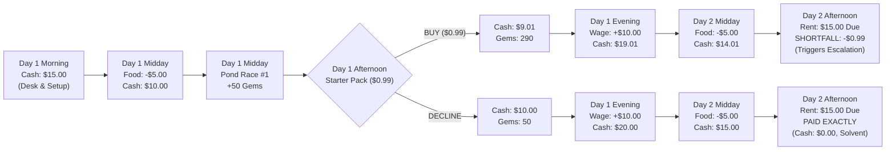
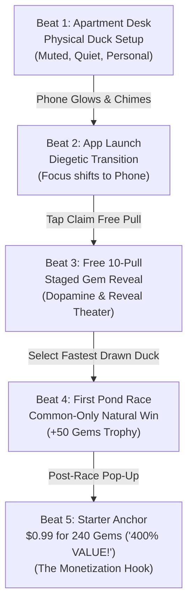

# Plan 12 Proposal: Guided Opening and Progressive Shop Progression (Repair 02)

**Date:** 2026-10-24  
**Type:** Investigation & UX Architecture Proposal  
**Status:** Delivered for Owner Review (Repair 02)  
**Author:** Implementer Thread (Plan 12)  
**Scope:** `reports/development/plan-12-guided-opening-and-shop-progression/`  

---

## 1. Executive Summary and Investigation Mandate

Plan 03 proved the core mechanics of Quackpot—local browser saving, seedable deterministic PRNG, append-only event logging, and an honest end-of-run Receipt derived solely from recorded cues. As established in [`reports/orchestration/plan-03-owner-play-feedback.md`](file:///C:/AI/Quackpot/reports/orchestration/plan-03-owner-play-feedback.md), the initial proof presented a bare website layout where currencies, buttons, and rules appeared without diegetic context. The owner directed:

1. **Exposition through play:** Introduce Gems, duplicates, and Down sequentially in context. Do not force learners to sit through an opening lecture or hunt for unexplained buttons.
2. **Enticing opening invitation:** Make the first transition from the metagame character's apartment into the fictional gacha app visually enticing (diegetic phone glow, vibrant welcome screen, synthesized audio cues), coordinated with Plan 14's stage layout and Plan 11's visual compositions, while retaining an accessible, silent, reduced-motion path and immediate exit.
3. **Progressive shop complexity:** Start with an uncluttered, welcoming starter anchor ($0.99 for 240 gems labeled "400% value" per canonical O11), and progressively reveal predatory mechanics—odd bundle sizing, leftover currency traps, and the intentionally near-useless Down shop—without withholding purchase terms or turning disclosures into deceptive odds navigation.
4. **Honest PRNG integrity:** Never silently rig the PRNG to force a teaching duplicate. Defer Down introduction until a duplicate actually occurs naturally.
5. **Repair 02 Precision:** Corrects the cash timeline to strictly match Plan 03's approved trial sequence (Day 1 start $15 $\rightarrow$ food $10 $\rightarrow$ starter purchase $9.01 $\rightarrow$ wage $19.01 $\rightarrow$ Day 2 food $14.01 $\rightarrow$ rent shortfall $0.99), defines coherent explicit mock fixtures for Case A (4 duplicates = 4 Down) and Case B (10 unique ducks = 0 Down), restores the approved **400% value** promotional anchor, and cleanly distinguishes starter-pack-alone pull math from total post-race gem balances.

---

## 2. Reference Configuration vs. Unadopted Future Proposals

To ensure mathematical and architectural consistency, all values across this proposal and its accompanying wireframes distinguish between the **Plan 03 Accepted Trial Baseline** and **Illustrative Future Proposals**:

| Parameter | Plan 03 Accepted Trial Baseline (Reference) | Illustrative Future Proposal (Unadopted) | Status & Governance |
| :--- | :--- | :--- | :--- |
| **Game Title** | *Quackpot* | Fictional store banners may use satirical event labels | Canonical name is *Quackpot* (Hard Constraint #6; no unapproved branded subtitle). |
| **Starting Cash** | **$15.00** | — | Accepted Plan 03 trial constant (`GAME_CONSTANTS.START_CASH`). |
| **Starting Health** | **100%** | — | Accepted Plan 03 trial constant. |
| **Day-1 Food Bill** | **-$5.00** (deducted midday before race/starter) | — | Accepted Plan 03 trial constant (`FOOD_DAILY`). Leaves cash at $10.00. |
| **Starter Pack Offer** | **$0.99 for 240 Gems**, labeled **"400% value"** (gems-only, no cosmetic accessory) | $0.99 for 1,200 Gems + cosmetic cap | Trial starter is $0.99/240 gems with "400% value" anchor (O11). Larger bundles remain unadopted proposals. |
| **Day-1 Wage** | **+$10.00** (credited evening) | — | Accepted Plan 03 trial constant (`WAGE_DAILY`). |
| **Day-2 Food Bill** | **-$5.00** (deducted midday) | — | Accepted Plan 03 trial constant (`FOOD_DAILY`). Leaves cash at $14.01 (bought) vs $15.00 (declined). |
| **Day-2 Rent Bill** | **$15.00** (due Day 2 afternoon) | — | Accepted Plan 03 trial constant (`RENT_DAY2`). Shortfall is -$0.99 if starter was bought. |
| **Pull Cost** | **160 Gems** (single) / **1,600 Gems** (ten-pull) | — | Provisional founding design constants (§Core loop). |
| **Base Draw Odds** | **Common 80.0%, Rare 18.0%, Legendary 2.0%** | — | Accepted Plan 03 trial model (`calculatePreDrawOdds`). |
| **Roster Pool** | **6 Identities** (`duck-0` to `duck-5`: 3 Common, 2 Rare, 1 Legendary) | Expanded roster ($\ge 10$ identities) | Current trial pool is 6 identities. Larger rosters remain future content waves. |
| **Down Conversion** | Common: 1 Down, Rare: 5 Down, Legendary: 20 Down | Uniform flat conversion (e.g. 10 Down/dup) | Accepted Plan 03 trial constant (`DOWN_PER_DUPLICATE`). |
| **Odds Detail Modal** | Placeholder hook only: `[View Odds & Pity Details]` | Detailed carry/reset and schedule copy | **Plan 06 gate:** Optional odds detail wording remains draft/unadopted. |

*Governance Citation Note:* Quackpot is governed strictly by the **seven hard constraints** in `docs/founding/design.md` §Hard constraints. Duplicates and Down are governed by founding design §Core loop ("Duplicates and Down"), §Manipulation catalog ("Secondary-currency obfuscation"), and owner triage GATE-53B (O8). No "Hard Constraint #50" exists.

---

## 3. The Approved Trial Financial Timeline

To accurately reflect the economic squeeze that CourseVGD students experience, the timeline must account for intervening living expenses:



### 3.1 Cash State at the Starter Pack Decision Point
When the starter pack pop-up appears in Beat 5 (Day 1 Afternoon):
- **Cash is $10.00** (not $15.00, because Day 1 food of $5.00 has already been paid).
- If the player purchases the pack for **$0.99**, immediate cash drops to **$9.01**.
- If the player declines the pack, cash remains **$10.00**.
- **The Consequential Squeeze:** The $0.99 purchase seems harmless against $10.00 cash, but because Day 1 wage (+$10.00) and Day 2 food (-$5.00) net out to +$5.00, cash reaches Day 2 rent at **$14.01**. The student falls exactly **$0.99 short** of the $15.00 rent bill! Declining the pack leaves cash at **$15.00**, allowing rent to be paid exactly in full.

### 3.2 Gem Pull Mathematics: Pack-Alone vs Total Post-Race Balance
To prevent learner confusion, helper disclosures distinguish between pack-alone math and total account balance:
1. **Starter Pack Alone (240 Gems):**
   - Cost: $0.99.
   - At 160 gems/pull, 240 gems provides exactly **1 single pull** with **80 leftover gems** (exactly half a pull; 80 gems short of a second pull; 400 gems short of a ten-pull).
   - Effective cost per pull in pack alone: $0.66.
2. **Total Post-Race Account Balance (50 Race Gems + 240 Starter Gems = 290 Gems):**
   - The player earned 50 Gems from winning Pond Race #1.
   - Combined balance is **290 Gems**.
   - 290 Gems allows exactly **1 single pull** (160 gems), leaving **130 leftover gems** (infuriatingly 30 gems short of a second single pull).

---

## 4. Opening Beat Map: Recommended vs Alternative

Canonical chronology (`docs/founding/design.md` §The five-minute experience) dictates:
1. Meet physical rubber duck, name and style it.
2. Enter fictional gacha game.
3. Receive free 10-pull and inspect roster.
4. Race and win first Pond Race.
5. Encounter the $0.99 starter offer.

### 4.1 Recommended Sequence: "Diegetic Smartphone Glow & Tactile Discovery"



#### Detailed Recommended Beat Specifications

| Beat | What Player Sees | What Player Does | What Player Learns | Sensory Cues (Standard) | Accessible Equivalent (Screen Reader & Reduced Motion) | Proposed Event Mapping (`EventLog`) |
| :--- | :--- | :--- | :--- | :--- | :--- | :--- |
| **Beat 1: Physical Duck Motivation** | Quiet apartment desk. One 2D physical rubber duck (Plan 10 styling). Cash: $15.00, Rent: $15.00 due Day 2. A dark smartphone sits on the desk blotter. | Names duck (default: "Bubbles"), selects physical accessory (e.g. Classic Yellow, Tiny Necktie, Chef Cap), clicks "Place on Desk". | The physical duck is personal, inanimate, and distinct from digital collectibles. Cash/Rent are immediate real-world constraints. | Soft paper rustle; gentle lamp warm glow. | High-contrast static desk view; form controls labeled with semantic HTML; no motion required. | `action: { kind: 'own_duck_customized', name: 'Bubbles', style: 'tie' }` |
| **Beat 2: The Enticing Invitation & App Launch** | Smartphone screen illuminates with warm gold light and a pulsing icon. A notification reads: *"SPECIAL ROOKIE GIFT! Free 10-Pull Waiting! Tap to Play Quackpot!"* | Clicks the glowing smartphone screen or "Open Quackpot" button. | The fictional gacha game promises instant free gratification without upfront payment or registration. | Synthesized duck squeak + cheerful ascending chime. Framing shifts to phone viewport. | Smartphone has `role="button" aria-label="Smartphone notification: Open Quackpot app for Free 10-Pull"`. Reduced motion uses instant opacity cross-fade. | `action: { kind: 'app_entered', source: 'rookie_invitation' }` |
| **Beat 3: The Free 10-Pull & Staged Gems** | In-app gacha banner. Top bar shows `Gems: ???` (unlit) and `Cash: $15.00`. Center features a prominent button: *"CLAIM FREE ROOKIE 10-PULL"*. | Clicks "CLAIM FREE 10-PULL". Observes card reveals (or clicks "Skip Theater / Reveal All"). | Pulling ducks is sensory and cost-free at first. Gems are introduced *after* the pull: balance illuminates to `0 Gems` with note: *"160 Gems needed per standard pull"*. | Drumroll / sparkle sweep on card flips; gold ray flash on highest-tier card. | "Skip Theater / Reveal All" button immediately visible and keyboard focused. Cards read out via `aria-live="polite"` with rarity, name, and speed. | `cue: { kind: 'free_ten_pull_offered' }`, followed by `draw` and `reveal` events with actual pre-draw odds. |
| **Beat 4: First Pond Race & Natural Win Payoff** | App switches to "Pond Race" tab. (Day 1 Food of $5.00 is paid midday, leaving cash at $10.00). Player slots Common `Rubber Mallard` (Speed 10.0) against tutorial bots (Field Speed 8.0). | Clicks "Start Race". Observes fixed-duration race (~4–6s). | Races are won through duck stats. Common ducks easily win the tutorial race. Post-race banner awards `+50 Gems! 1st Place!`. | Water splashing sound, crowd quack cheer, victory brass fanfare. | Race course summarized in accessible text table; reduced motion shows static lap indicators; victory toast announces placement and gems. | `bill: { kind: 'food', amount: 5.00 }` $\rightarrow$ `race_choice_offered` $\rightarrow$ `action: { kind: 'race_choice_selected' }` $\rightarrow$ `race_result: { place: 1, rewardGems: 50 }` |
| **Beat 5: The Starter Squeeze & Anchoring** | Returning to app home, a promotional modal appears: *"ROOKIE STARTER PACK — 400% VALUE! 240 Gems for ONLY $0.99 (Reg. $1.99)"*. Cash is $10.00. | Reviews offer: can click "Buy for $0.99" (cash drops to $9.01) or click "Maybe Later" / "X" (cash remains $10.00). | Winning immediately triggers monetization. The $0.99 anchor feels small against $10.00 cash, but directly causes the Day-2 rent shortfall ($0.99). | Cash register chime, pulsing gold badge. | Modal has `role="dialog" aria-modal="true"`; keyboard focus trapped inside; `Escape` key dismisses cleanly without penalty. | `cue: { kind: 'starter', gems: 240, price: 0.99, anchorLabel: '400% value' }` $\rightarrow$ `action: { kind: 'starter_bought' | 'starter_declined' }` |

---

### 4.2 Alternative Sequence: "Split-Screen Desktop & Social Ad Invitation"

- **Alt Beat 1:** Character browses apartment laptop; social video ad pops up promoting Quackpot.
- **Alt Beat 2:** Side-by-side split screen (apartment on left, game app on right).
- **Alt Beat 3:** Pull screen displays a live scrolling ticker of fictional players ("Xx_Quacker_xX won Legendary!").
- **Alt Beat 4:** Race matched against an online ghost profile.
- **Alt Beat 5:** Starter offer framed as "Catch Up Pack: $0.99".

#### Comparison and Trade-Off Analysis

| Dimension | Recommended (Diegetic Phone Glow) | Alternative (Split-Screen Social Ad) | Pedagogical Impact in CourseVGD |
| :--- | :--- | :--- | :--- |
| **Diegetic Immersion** | **High.** Maintains the character's physical desk space and treats the phone as an in-world gateway. | **Moderate.** Treats the app as an adjacent browser window, feeling like a desktop website. | Recommended reinforces Hard Constraint #146 ("one fixed diegetic stage") and makes physical desk vs digital app contrast palpable. |
| **Streamer Boundary** | **Clean.** Strictly respects D1 deferral of the streaming branch (`owner-triage.md`). | **Borderline.** Relies on fictional streamer clips and social tickers, encroaching on deferred streamer mechanics. | Recommended avoids premature feature creep and keeps focus strictly on the gacha core loop. |
| **Cognitive Load for Beginners** | **Low.** Single clear focal point at each beat. Gems introduced only after pull #1. | **High.** Split screen divides attention; live ticker distracts from card readability and odds mechanics. | Recommended allows all students to follow the exact relationship between currency and pulls without UI clutter. |
| **Receipt Attribution** | **Direct.** Displays: Free Pull, 1st Win (+50 Gems), $0.99 Starter Offer. Clear 1-to-1 causal attribution. | **Diffused.** Ticker and ghost leaderboard cues create ambiguous social comparison claims that are harder to isolate on the Receipt. | Recommended guarantees clean O1 attribution (*We displayed / You did / Did this affect you?*). |

**Recommendation:** Proceed with the **Diegetic Smartphone Glow** sequence.

---

## 5. Staged Resource Introduction & Mock Fixture Specifications

### 5.1 Roster Mathematics & The Anti-Rigging Principle
- In Plan 03's accepted 6-identity roster (`BANNER_1_ROSTER`: 3 Common, 2 Rare, 1 Legendary), drawing 10 cards mathematically guarantees duplicates (Pigeonhole Principle: $\ge 4$ duplicates). Case A is the only reachable natural outcome under the current roster.
- In future content waves where the roster expands ($\ge 10$ identities), drawing 10 unique ducks becomes mathematically possible.
- **Anti-Rigging Rule:** The PRNG stream is never tampered with to force a duplicate or a unique draw.

---

### 5.2 Explicit Mock Fixtures: Case A vs. Case B

To guarantee that cards, HUD balances, helper text, and mock Receipt samples agree identically, two separate explicit fixtures are defined:

#### Fixture A (Current 6-Identity Trial Roster Mockup)
Drawn from `BANNER_1_ROSTER` (`duck-0` to `duck-5`):
1. `duck-1` **Rubber Mallard** (Common, Spd 10.0) — `[NEW!]`
2. `duck-0` **Puddle Quacker** (Common, Spd 10.0) — `[NEW!]`
3. `duck-3` **Bath Cadet** (Common, Spd 10.0) — `[NEW!]`
4. `duck-2` **Pond Rocket** (Rare, Spd 14.0) — `[NEW!]`
5. `duck-4` **Turbo Drake** (Rare, Spd 14.0) — `[NEW!]`
6. `duck-5` **Biblically Accurate Duck** (Legendary, Spd 20.0) — `[NEW!]`
7. `duck-1` **Rubber Mallard** (Common) — `[DUPLICATE] -> +1 Down`
8. `duck-0` **Puddle Quacker** (Common) — `[DUPLICATE] -> +1 Down`
9. `duck-3` **Bath Cadet** (Common) — `[DUPLICATE] -> +1 Down`
10. `duck-1` **Rubber Mallard** (Common) — `[DUPLICATE] -> +1 Down`

- **Derived Fixture Properties:**
  - Total cards: 10.
  - Unique identities owned: 6/6.
  - Duplicate cards: Exactly 4 (all Common).
  - Down credited: **4 Down** (1 Down per Common duplicate).
  - HUD Down counter: **"Down: 4"**.
  - Mock Receipt Text: *"4 reveal(s) showed a duplicate converted to Down, 4 Down in total."*

#### Fixture B (Hypothetical Expanded 16-Identity Roster Mockup)
Ten distinct identities representing an expanded roster:
1. `duck-1` **Rubber Mallard** (Common, Spd 10.0) — `[NEW!]`
2. `duck-0` **Puddle Quacker** (Common, Spd 10.0) — `[NEW!]`
3. `duck-3` **Bath Cadet** (Common, Spd 10.0) — `[NEW!]`
4. `duck-2` **Pond Rocket** (Rare, Spd 14.0) — `[NEW!]`
5. `duck-4` **Turbo Drake** (Rare, Spd 14.0) — `[NEW!]`
6. `duck-5` **Biblically Accurate Duck** (Legendary, Spd 20.0) — `[NEW!]`
7. `duck-6` **Stream Glider** (Common, Spd 10.0) — `[NEW!]`
8. `duck-7` **Foam Cruiser** (Common, Spd 10.0) — `[NEW!]`
9. `duck-8` **Speckled Diver** (Rare, Spd 14.0) — `[NEW!]`
10. `duck-9` **Canvas Quacker** (Common, Spd 10.0) — `[NEW!]`

- **Derived Fixture Properties:**
  - Total cards: 10.
  - Unique identities owned: 10/16.
  - Duplicate cards: **0**.
  - Down credited: **0 Down**.
  - HUD Down counter: **Hidden**.
  - Down Shop Tab: **Locked** (*"Down Exchange unlocks when you draw a duplicate duck"*).
  - Mock Receipt Text: Zero secondary-currency entries (strictly omitted per O1).

---

## 6. Progressive Shop Progression: Stage 1 vs Stage 2

### 6.1 Stage 1: The Introductory Offer (The Anchor)

Appears immediately after the first Pond Race victory (Day 1 Afternoon).

```
+--------------------------------------------------------------------------+
|  QUACKPOT STORE >> SPECIAL ROOKIE CELEBRATION                            |
+--------------------------------------------------------------------------+
|                                                                          |
|   ********************************************************************   |
|   *             ROOKIE STARTER PACK -- 400% VALUE!                   *   |
|   *                                                                  *   |
|   *    [ Mockup SVG: Glowing Starter Ducky Box ]                     *   |
|   *                                                                  *   |
|   *    Contains:                                                     *   |
|   *      - 240 Premium Gems                                          *   |
|   *                                                                  *   |
|   *    Price: $0.99  (Fictional Bank Balance: $10.00)                 *   |
|   *                                                                  *   |
|   *    [ BUY NOW FOR $0.99 ]                 [ Maybe Later ]         *   |
|   ********************************************************************   |
|                                                                          |
|   (i) Honest Purchase Disclosure (Mockup):                               |
|       - Standard pull cost: 160 Gems.                                    |
|       - Pack alone: 240 Gems allows 1 single pull (160 Gems) with        |
|         80 leftover Gems (half a pull; 80 short of a second single).     |
|       - Combined with 50 race gems (290 total): allows 1 pull with       |
|         130 leftover Gems (30 gems short of a second pull).              |
|       - Purchasing leaves $9.01 cash. After Evening Wage (+$10) and      |
|         Day 2 Food (-$5), cash reaches $14.01 before the $15.00 rent bill|
|         (a $0.99 shortfall).                                             |
|       - "400% value" is a fictional publisher comparison claim.          |
+--------------------------------------------------------------------------+
```

### 6.2 Stage 2: The Complex Store (Unadopted Future Proposal)

> [!NOTE]
> The multi-tier bundles and sample Down exchange rates below are **illustrative proposals** designed to demonstrate how odd bundle sizing and secondary currency obfuscation can be presented progressively. Final store tuning remains an open owner decision.

#### Tab 1: Gem Bundles & Currency Obfuscation (Proposal)

| Sample Bundle Tier | Fictional Price | Gems Granted | Pull Equivalent (@ 160 Gems/Pull) | Leftover Trap Analysis | Effective Cost per Pull |
| :--- | :--- | :--- | :--- | :--- | :--- |
| **Tier 1: Handful** | $0.99 | 320 Gems | Exactly 2 pulls (320 gems) | **0 leftover gems** | ~$0.50 / pull |
| **Tier 2: Sack (Popular)** | $4.99 | 1,750 Gems | 1 Ten-Pull (1,600 gems) | **150 leftover gems** (infuriatingly 10 gems short of an 11th pull!) | ~$0.45 / pull |
| **Tier 3: Chest (Best Value)**| $9.99 | 3,600 Gems | 2 Ten-Pulls (3,200) + 2 Singles (320) | **80 leftover gems** (trapped unspendable currency) | ~$0.44 / pull |

#### Tab 2: The Near-Useless Down Exchange (Proposal)

| Sample Down Item | Cost in Down | Duplicate Ducks Required (at Sample Rates) | Pedagogical Classroom Value |
| :--- | :--- | :--- | :--- |
| **Slightly Soggy Breadcrumb** | 15 Down | 15 Common duplicates (representing 2,400 gems pulled) | Consumable item (+0.5% speed for 1 race) demonstrating pathetic purchasing power. |
| **Plastic Duck Whistle** | 50 Down | 50 Common duplicates (representing 8,000 gems pulled) | Audio cosmetic demonstrating high cost for zero gameplay utility. |
| **Single Pull Voucher** | 100 Down | 100 Common duplicates (representing 16,000 gems pulled) | Demonstrates an unviable recycling ratio: sacrificing 100 ducks to get 1 draw back. |

---

### 6.3 Coordination with Plan 06 (Optional Odds-Detail Interface)

Plan 06 owns the decision on optional odds-detail content, placement, and wording. Plan 12 defines only the UI interface hook:
1. **Placeholder Button:** A neutral button labeled `[View Odds & Pity Details]` is placed on banner and store headers.
2. **Behavior:** Clicking opens a neutral disclosure modal. In the wireframe, this displays the trial baseline odds (Common 80%, Rare 18%, Legendary 2%) and pity counter placeholder.
3. **Receipt Contract:** Logs `cue: { kind: 'odds_detail_viewed' }`. The Receipt continues to report actual pre-draw conditional odds on every pull regardless of whether the player opened this modal.

---

## 7. Mock Receipt Attribution Preview

```
================================================================================
                    QUACKPOT RUN RECEIPT (MOCKUP SAMPLE)
================================================================================
[TECHNIQUE: Anchoring]
  • WE DISPLAYED: Starter offer shown: 240 gems for $0.99, labelled "400% value".
  • YOU DID: Starter offer bought (Day 1 Afternoon). Fictional cash dropped from
    $10.00 to $9.01 (leading to Day 2 rent shortfall of $0.99).
  • DID THIS AFFECT YOU? Did the "400% value" comparison label on the starter
    offer affect your judgment of later offers?

[TECHNIQUE: Currency Obfuscation]
  • WE DISPLAYED: Standard pull cost: 160 gems. Starter pack: 240 gems.
  • YOU DID: Completed 1 pull (160 gems); left with 80 unspendable gems from pack
    (130 leftover gems including race prize).
  • DID THIS AFFECT YOU? Did the gem prices and leftover balances affect your
    purchases?

[TECHNIQUE: Secondary-Currency Obfuscation]
  • WE DISPLAYED: 4 reveal(s) showed a duplicate converted to Down, 4 Down in total.
  • YOU DID: No Down spending recorded.
  • DID THIS AFFECT YOU? Did Down affect how you valued duplicate ducks?
================================================================================
```

---

## 8. Concise Owner Decision List

### 8.1 Decisions Unchanged & Preserved
- Seven Hard Constraints (`docs/founding/design.md`).
- Single fixed diegetic stage (apartment desk + phone viewport).
- Plan 03 accepted trial parameters ($15.00 starting cash, $15.00 rent, $5 food, $10 wage, 80/18/2 base odds, 160 pull cost, $0.99 for 240 gems starter).
- Approved **"400% value"** promotional anchor label (O11).
- Plan 06 authority over optional odds detail and pity disclosures.

### 8.2 Pending Owner Decisions (Plan 12 Recommendations)
1. **Opening Beat Sequence:** Approve the Recommended 5-Beat Map (Apartment Desk $\rightarrow$ Phone Glow $\rightarrow$ Free 10-Pull $\rightarrow$ 1st Win $\rightarrow$ Starter Anchor).
2. **Contextual Currency Staging:** Approve staging Gems (dormant on Beat 3, illuminated post-pull/post-race) and Down (hidden until first duplicate).
3. **Honest Fallback Architecture:** Approve the anti-rigging principle (Case A natural duplicates in current roster; Case B honest fallback in future expanded rosters).
4. **Shop Progression Staging:** Approve Stage 1 single starter anchor vs Stage 2 multi-tier odd bundle presentation.

### 8.3 Follow-On Implementation Prerequisites
- A dedicated implementation packet (e.g. Plan 12 Implementation) with bounded scope.
- Coordination with Plan 14 (Stage Layout) for the final phone framing transition.
- Coordination with Plan 04 (SVG Rig) for production duck rendering.
