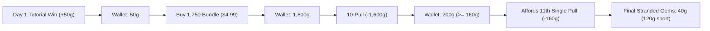

# Plan 17: Down Exchange and Whole-Wallet Validation — Final Evidence & Proposal

**Date:** 2026-10-25  
**Status:** Completed Proposal & Evidence (Scenario Pass Executed)  
**Packet:** [`docs/development/plan-17-down-exchange-and-wallet-validation.md`](file:///c:/AI/Quackpot/docs/development/plan-17-down-exchange-and-wallet-validation.md)  
**Scope:** Strictly bounded to `reports/development/plan-17-down-exchange-and-wallet-validation/`. Existing `sim/` and `src/` modules are read-only references.

---

## 1. Executive Summary & Calibration Context

In the Plan 12 owner interview and orchestration triage ([DECISION-008](file:///c:/AI/Quackpot/docs/decision-log.md#L97-L110) and [DECISION-009](file:///c:/AI/Quackpot/docs/decision-log.md#L111-L120)), the owner refined the Down economy:
1. **Target Calibration:** **3 Down** for a minor temporary speed item, and **6 Down** for a single-pull ticket, alongside the **1,750-gem** odd-bundle tier ($4.99).
2. **Approved Scenario Rules (Orchestration Review):**
   - **Rule T1 A:** Draws bought with Down award normal rarity-weighted Down on duplicates (Common: 1, Rare: 5, Legendary: 20).
   - **Rule T2 A:** Draws bought with Down use conditional banner odds, advance the normal pity counter once, and **explicitly reset pity to 0 upon drawing a Legendary**.
   - **Rule T3 A:** Immediate active-banner redemption labeled **“Pull with Down — 6 Down”**; Down remains bankable in the wallet.
   - **Rule I1:** Minor speed item provides **+5.0% base speed** for one race (non-stacking), consumed strictly once when the race commits.

This report establishes the verified mathematical and simulation evidence supporting these owner targets, correcting earlier proxy assumptions, documenting integer bank-state recycling, proving non-self-funding decay, and reconciling isolated bundle arithmetic with real whole-wallet progressions.

---

## 2. Six-Identity Duplicate Payouts and Opening Distributions

### 2.1 Roster Structure & Multinomial Basis
The active Banner 1 roster ([`BANNER_1_ROSTER`](file:///c:/AI/Quackpot/src/core/game-engine.mjs#L15-L22)) contains exactly 6 identities across 3 tiers:
- **Common (3 identities, 80.0% base odds):** `duck-0`, `duck-1`, `duck-3` ($p_C = 0.80 / 3 \approx 0.266667$ each). Duplicate payout: **1 Down**.
- **Rare (2 identities, 18.0% base odds):** `duck-2`, `duck-4` ($p_R = 0.18 / 2 = 0.090000$ each). Duplicate payout: **5 Down**.
- **Legendary (1 identity, 2.0% base odds):** `duck-5` ($p_L = 0.020000$). Duplicate payout: **20 Down**.

Because outcomes are governed by independent draws from unequal category probabilities, the opening distribution is evaluated over all non-equiprobable count vectors $\mathbf{k} = (k_1, \dots, k_6)$ summing to 10 with multinomial mass:
$$P(\mathbf{k}) = \frac{10!}{\prod_{i=1}^6 k_i!} \prod_{i=1}^6 p_i^{k_i}$$

### 2.2 Reconciled Opening Probabilities
By the Pigeonhole Principle, drawing 10 cards across 6 distinct identities guarantees at least $10 - 6 = 4$ duplicate cards. It is impossible to receive fewer than 4 duplicate cards.

#### Duplicate Cards Distribution
| Duplicate Cards | Exact Probability | Cumulative |
| :---: | :---: | :---: |
| **4** | 4.2833% | 4.2833% |
| **5** | 34.1784% | 38.4617% |
| **6** | 46.2870% | 84.7487% |
| **7** | 14.6737% | 99.4224% |
| **8** | 0.5770% | 99.9995% |
| **9** | 0.0005% | 100.0000% |

- **Mean duplicate cards:** **$5.7308$**
- **Median duplicate cards:** **6**

#### Down Feathers Gained Distribution
| Down Gained | Exact Probability | Cumulative | Exchange Affordability |
| :---: | :---: | :---: | :--- |
| **4** | 2.0200% | 2.0200% | Affords 1 speed item (3 Down); 2 Down short of ticket. *(Plan 03 fixture)* |
| **5** | 16.0293% | 18.0493% | Affords 1 speed item (3 Down); 1 Down short of ticket. |
| **6** | 26.8080% | 44.8573% | **Affords 1 ticket (6 Down) or 2 speed items**. |
| **7** | 12.2740% | 57.1313% | **Median Down (7 Down)**. Affords 1 ticket + 1 Down remainder. |
| **8** | 1.9885% | 59.1198% | 1 ticket + 2 Down remainder. |
| **9** | 11.6019% | 70.7217% | 1 ticket + 3 Down remainder (or 3 speed items). |
| **10** | 13.1378% | 83.8595% | 1 ticket + 4 Down remainder (or 3 speed items + 1 remainder). |
| **11 – 13** | 6.4149% | 90.2744% | 1 to 2 tickets. |
| **14** | 4.4933% | 94.7677% | **2 tickets (12 Down) + 2 Down remainder**. |
| **15 – 24** | 4.5458% | 99.3135% | Multiple tickets or mixed item baskets. |
| **25** | **0.3719%** | 99.6854% | **Windfall:** Affords 4 tickets (24 Down) + 1 Down remainder. |
| **26+** | 0.3146% | 100.0000% | High-windfall tail (multiple Rare/Legendary duplicates). |

#### Reconciled Summary Metrics:
- **$\mathbf{P(\text{Down} \ge 3) = 100.0000\%}$:** Every single player drawing the initial free 10-pull earns at least 4 Down. **100% of students can afford the 3-Down minor speed item.**
- **$\mathbf{P(\text{Down} \ge 6) = 81.9507\%}$:** Over 4 out of 5 students (~82%) can afford at least one **6-Down pull ticket** immediately.
- **$\mathbf{P(\text{Down} < 6) = 18.0493\%}$:** Only ~18% of students experience a shortfall of 1 or 2 Down to reach a ticket.
- **Mean Down:** **$8.3706$** Down.
- **Median Down:** **$7$** Down.

### 2.3 Representative 10-Card Opening Traces

#### Trace 1: Low Tail Opening (4 Down — 2.02% probability)
*Plan 03 static trial fixture equivalent. Draws all 6 unique identities, yielding 4 Common duplicates:*
- Cards 1–6: `duck-0` (C, NEW), `duck-1` (C, NEW), `duck-3` (C, NEW), `duck-2` (R, NEW), `duck-4` (R, NEW), `duck-5` (L, NEW).
- Cards 7–10: `duck-0` (C, DUP, +1), `duck-1` (C, DUP, +1), `duck-3` (C, DUP, +1), `duck-0` (C, DUP, +1).
- **Summary:** 4 Duplicates, **4 Down**. Affords 1 speed item (3 Down); 2 Down short of ticket.

#### Trace 2: Median / Typical Opening (7 Down — 12.27% probability)
*Drawn from 3 unique Common identities ($k_C = [2, 3, 5]$, Rares/Legendary not drawn), yielding 7 Common duplicates:*
- Cards 1–3: `duck-0` (C, NEW), `duck-1` (C, NEW), `duck-3` (C, NEW).
- Cards 4–10: `duck-0` (+1), `duck-1` (+1), `duck-1` (+1), `duck-3` (+1), `duck-3` (+1), `duck-3` (+1), `duck-3` (+1).
- **Summary:** 7 Duplicates, **7 Down**. Affords 1 ticket (6 Down) with 1 Down remainder, or 2 speed items + 1 remainder.

#### Trace 3: Upper-Middle Opening (10 Down — 13.14% probability)
*Count vector $[3, 2, 3, 2, 0, 0]$ (4 unique identities, 1 Rare duplicate + 5 Common duplicates):*
- Cards 1–4: `duck-0` (C, NEW), `duck-1` (C, NEW), `duck-3` (C, NEW), `duck-2` (R, NEW).
- Card 5: `duck-2` (R, DUP, **+5 Down**).
- Cards 6–10: `duck-0` (+1), `duck-0` (+1), `duck-1` (+1), `duck-3` (+1), `duck-3` (+1).
- **Summary:** 6 Duplicates, **10 Down**. Affords 1 ticket (6 Down) with 4 Down remainder, or 3 speed items + 1 remainder.

#### Trace 4: Legendary Windfall Opening (25 Down — 0.3719% probability)
*Count vector $[0, 0, 6, 1, 1, 2]$ (4 unique identities, 1 Legendary duplicate + 5 Common duplicates):*
- Cards 1–4: `duck-3` (C, NEW), `duck-2` (R, NEW), `duck-4` (R, NEW), `duck-5` (L, NEW).
- Card 5: `duck-5` (L, DUP, **+20 Down**).
- Cards 6–10: `duck-3` (+1), `duck-3` (+1), `duck-3` (+1), `duck-3` (+1), `duck-3` (+1).
- **Summary:** 6 Duplicates, **25 Down**. Affords **4 tickets (24 Down)** with 1 Down remainder.

---

## 3. Pooled-Bank Recurrence & Dynamic Recycling (Rules T1 A / T2 A / T3 A)

### 3.1 Correcting the Branching-Process Proof
An unweighted branching ratio ($2.10 / 6 = 0.35 \implies 1.5385$ draws) falsely assumes fractional ticket generation. In reality, Down is held in discrete integer balances, and ticket draws cost an indivisible 6 Down:
- When starting with exactly **6 Down**, the first draw costs 6 Down $\to$ bank drops to 0.
- A Common duplicate returns **+1 Down** (bank = 1; cannot afford another pull; 80% probability).
- A Rare duplicate returns **+5 Down** (bank = 5; cannot afford another pull; 18% probability).
- Only a Legendary duplicate returns **+20 Down** (bank = 20; affords 3 more pulls; 2% probability).
- **Result:** Under base odds and full ownership, **98% of players starting with 6 Down terminate immediately after exactly 1 draw**.

### 3.2 Exact Markov / Recurrence Evaluation (Base Odds, Full Ownership)
A finite-horizon recurrence tracking discrete transitions from bank state $B \ge 6$:
$$B \to \begin{cases} B - 5 & (p = 0.80) \\ B - 1 & (p = 0.18) \\ B + 14 & (p = 0.02) \end{cases}$$

| Starting Bank | Equivalent Immediate Tickets | Expected Total Draws | Remaining Live Mass | Steps to $\epsilon < 10^{-13}$ | Most Frequent Terminal Bank |
| :---: | :---: | :---: | :---: | :---: | :---: |
| **6 Down** | 1 ticket | **$1.08075$** | $8.97 \times 10^{-14}$ | 64 | 1 Down (78.4%), 5 Down (17.6%) |
| **12 Down** | 2 tickets | **$2.54461$** | $8.03 \times 10^{-14}$ | 71 | 2 Down (61.5%), 6 Down (recycled) |
| **18 Down** | 3 tickets | **$3.95109$** | $7.36 \times 10^{-14}$ | 77 | 3 Down (48.2%) |
| **20 Down** | 3 tickets + 2 remainder | **$4.03735$** | $7.28 \times 10^{-14}$ | 78 | 0 Down (38.4%), 4 Down (31.2%) |
| **24 Down** | 4 tickets | **$5.33516$** | $6.79 \times 10^{-14}$ | 83 | 4 Down (37.8%) |

*Key Insight on Non-Linearity:* Starting with 12 Down yields **$2.545$ expected draws** (more than $2 \times 1.08 = 2.16$). Because Draw 1 costs 6 Down, the bank drops to 6 Down; any duplicate returns at least +1 Down, guaranteeing that the bank remains $\ge 7$ Down for a 100% guaranteed second draw, where prior leftovers pool with subsequent returns.

### 3.3 Dynamic Pity Advancement & The Legendary Reset Boundary (Rule T2 A)
In dynamic play, ticket draws advance `pityCount` by 1. 50,000 Monte Carlo runs per scenario confirm the following:

| Starting Pity State | Starting Bank | Mean Draws | Max Cascade Observed | Rare Bounces per 100 Draws | Legendary Windfalls per 100 Draws |
| :---: | :---: | :---: | :---: | :---: | :---: |
| **Pity 0** (Reset) | 6 Down | **$1.081$** | 12 | 17.8% | 2.1% |
| **Pity 30** (Near Soft) | 6 Down | **$1.134$** | 15 | 17.6% | 3.4% |
| **Pity 49** (Hard Pity Boundary) | 6 Down | **$5.078$** | 21 | 16.9% | 20.4% *(1st draw guaranteed)* |
| **Pity 49 (Frozen / No Reset Counterexample)** | 6 Down | **$> 2,000$** | **2,001 (Safety Cap)** | N/A | **100.0% (Infinite Runaway)** |

#### Resolution of the Frozen Pity Ambiguity:
If ticket draws kept pity at 49 without resetting, every single draw yields a Legendary duplicate (+20 Down, net $+14$ Down per draw), creating a runaway infinite loop.  
**Rule T2 A prevents this entirely:** At pity 49, the guaranteed Legendary grants 20 Down, but **immediately resets pity to 0**. The 20 Down then decays at base odds, yielding an expected total of ~5.08 draws before complete extinction.

---

## 4. Pond Race Consumable Item Resolution (Option I1)

### 4.1 Race Resolution Engine & Quadrature Formulation
In [`src/core/game-engine.mjs`](file:///c:/AI/Quackpot/src/core/game-engine.mjs#L267-L295):
- Player entered with duck base speed $S = 10.0$ (Common).
- Stances: Safe Pace (noise $\pm 5\%$, span $1.00$); Sprint Push ($1.10 S$, noise $\pm 20\%$, span $4.40$).
- Opponents: 5 independent entrants with base speed $S_{\text{opp}} \times [1 \pm 0.05]$.
- First-place probability is evaluated via numerical quadrature:
$$P(\text{Win}) = \int_{\text{perf}_{\min}}^{\text{perf}_{\max}} \left[ \text{CDF}_{\text{opp}}(x) \right]^5 \cdot \frac{1}{\text{perf}_{\max} - \text{perf}_{\min}} \, dx$$

### 4.2 Exact Quadrature vs. Paired Monte Carlo (20,000 Races)

| Race Context | Duck & Stance | Item Boost | Speed Range | Quadrature 1st Place | Simulated 1st Place | Mean Gems Payout |
| :--- | :--- | :---: | :---: | :---: | :---: | :---: |
| **Finale (Field 11.2)** | Common Sprint | None (Baseline) | $[8.80, 13.20]$ | **36.9697%** | 37.14% | 20.91g |
| **Finale (Field 11.2)** | Common Sprint | **+5.0% (Option I1)** | $[9.24, 13.86]$ | **49.4949%** | 49.33% | 27.24g |
| **Finale Delta** | Common Sprint | **Option I1 Net** | — | **+12.5252%** | **+12.19%** | **+6.33g** |
| **Finale (Field 11.2)** | Common Safe | Baseline | $[9.50, 10.50]$ | **0.0000%** | 0.00% | 0.00g |
| **Finale (Field 11.2)** | Common Safe | **+5.0% (Option I1)** | $[9.98, 11.03]$ | **0.0173%** | 0.02% | 0.01g |
| **Tutorial (Field 8.0)**| Common Safe | Baseline | $[9.50, 10.50]$ | **100.0000%** | 100.00% | 50.00g |
| **Tutorial (Field 8.0)**| Common Safe | **+5.0% (Option I1)** | $[9.98, 11.03]$ | **100.0000%** | 100.00% | 50.00g |

### 4.3 Pedagogical Evaluation of Option I1:
1. **Observable Without Winning Guarantees:** On Sprint stance, +5% speed improves 1st place odds from ~37.0% to ~49.5% (+12.5 percentage points). The benefit is observable in race placings and yields ~6.3 additional gems in expectation, but does not guarantee victory (50.5% loss rate remains).
2. **Cannot Trivialize Safe Stance in Hard Races:** In Race 2, Common Safe with the item achieves only $0.017\%$ win rate against field 11.2. The item cannot bail out a player who refuses tactical risk.
3. **Tutorial Redundancy:** Baseline Common Safe already achieves $100.0\%$ win rate in the tutorial race. Spending Down on the item before Race 1 provides zero marginal benefit, exposing another player trap.
4. **Lifecycle & Consumption Contract:**
   - Consumed strictly once when the race commits.
   - Opening/closing the stance modal does not consume the item.
   - Page reload reconstructs state without re-consuming or double-awarding payouts.

---

## 5. Whole-Wallet Bundle Arithmetic vs. Isolated Odd-Bundle Traps

### 5.1 Isolated Remainder vs. Whole-Wallet Realities
The Plan 12 odd-bundle trap ($1,750 - 1,600 = \mathbf{150\text{ gems}}$, leaving a **10-gem shortfall** to a 160-gem pull) correctly describes pure bundle geometry. However, in whole-wallet play, players carry race rewards and pack leftovers:

### 5.2 Canonical Progression Paths Matrix

| Path ID & Scenario | Gems Before Purchase | Bundle / Purchase Added | Total Gems Available | After 10-Pull (1,600g) | Single Pulls Affordable | Final Stranded Remainder | True Shortfall to Next Pull |
| :--- | :---: | :---: | :---: | :---: | :---: | :---: | :---: |
| **Path 1: Pure Isolated Bundle** *(No prior play)* | 0g | +1,750g ($4.99) | 1,750g | 150g | 0 | **150g** | **10g short** *(The isolated trap)* |
| **Path 2: Tutorial Race Winner** *(Standard Day 1)* | 50g | +1,750g ($4.99) | 1,800g | 200g | **1** | **40g** | **120g short** |
| **Path 3: Starter Pack Purchaser** *(After 1 pull)* | 130g | +1,750g ($4.99) | 1,880g | 280g | **1** | **120g** | **40g short** |
| **Path 4: Starter Pack Alone** *($0.99 for 240g)* | 50g | +240g ($0.99) | 290g | N/A | **1** | **130g** | **30g short** |
| **Path 5: Two Race Wins** *(Day 1 + Day 2 = 100g)* | 100g | +1,750g ($4.99) | 1,850g | 250g | **1** | **90g** | **70g short** |

---

## 6. Receipt Accounting & Pedagogical Debrief Specifications

To preserve Hard Constraints #2 and #3 and avoid learner pushback:

### 6.1 Strict Currency Separation (Rule T4)
- **Cash Register:** Logs real-money purchases ($0.99 starter, $4.99 bundle).
- **Gem Register:** Logs gem spending (160 gems/pull).
- **Down Register:** Logs Down transactions separately (6 Down/ticket, 3 Down/speed item). Ticket pulls must **never** be logged as gem spending (160 gems) or zero-dollar cash spending.

### 6.2 Truthful Stranded Currency Reporting
- **Avoid Misleading "Wholly Stranded" Claims:** 5 Down is 1 short of a pull ticket, but can still purchase a 3-Down speed item. The Receipt must report:
  > *“You finished with 5 Down. While this was 1 Down short of a pull ticket, it was still enough to buy 1 speed item.”*
- **Distinguish Bundle Remainder from Wallet Remainder:**
  - *Inherent Bundle Geometry:* *“The 1,750 bundle tier was priced to leave 150 gems (10 gems short of a single pull).”*
  - *Observed Wallet Balance:* *“With your 50 gems from race rewards, your balance reached 200 gems, allowing you to make 1 more pull and leaving 40 gems unspent.”*

### 6.3 Question-Based Reflection
In accordance with CourseVGD guidelines, the *“Did This Affect You?”* register must present reflective prompts rather than psychological assertions:
- **Correct Prompt:** *“Did the availability of pull tickets in the Down exchange encourage you to keep drawing after your opening pulls?”*
- **Forbidden Assertion:** *“The Down exchange made you believe you were on a winning streak.”*

---

## 7. Delivery & Artifact Index

All supporting evidence, simulation scripts, and reproducible test suites are located within this folder:
- **Analytics Engine:** [`down-validation-engine.mjs`](file:///c:/AI/Quackpot/reports/development/plan-17-down-exchange-and-wallet-validation/down-validation-engine.mjs)
- **Automated Test Suite (100% Passing):** [`scenarios.test.mjs`](file:///c:/AI/Quackpot/reports/development/plan-17-down-exchange-and-wallet-validation/scenarios.test.mjs)
- **Scenario Evidence Generator:** [`run-scenarios.mjs`](file:///c:/AI/Quackpot/reports/development/plan-17-down-exchange-and-wallet-validation/run-scenarios.mjs)
- **Structured Data Artifact:** [`results.json`](file:///c:/AI/Quackpot/reports/development/plan-17-down-exchange-and-wallet-validation/results.json)
- **Progress Report:** [`progress.md`](file:///c:/AI/Quackpot/reports/development/plan-17-down-exchange-and-wallet-validation/progress.md)

No shared `sim/` or `src/` modules were modified. No packet frontmatter status or git push operations were performed.
