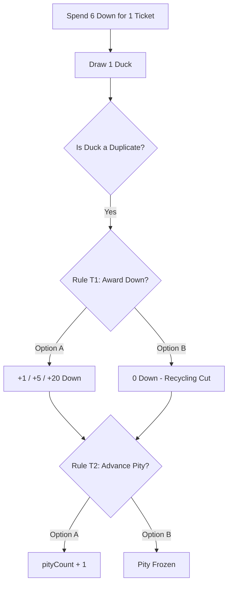
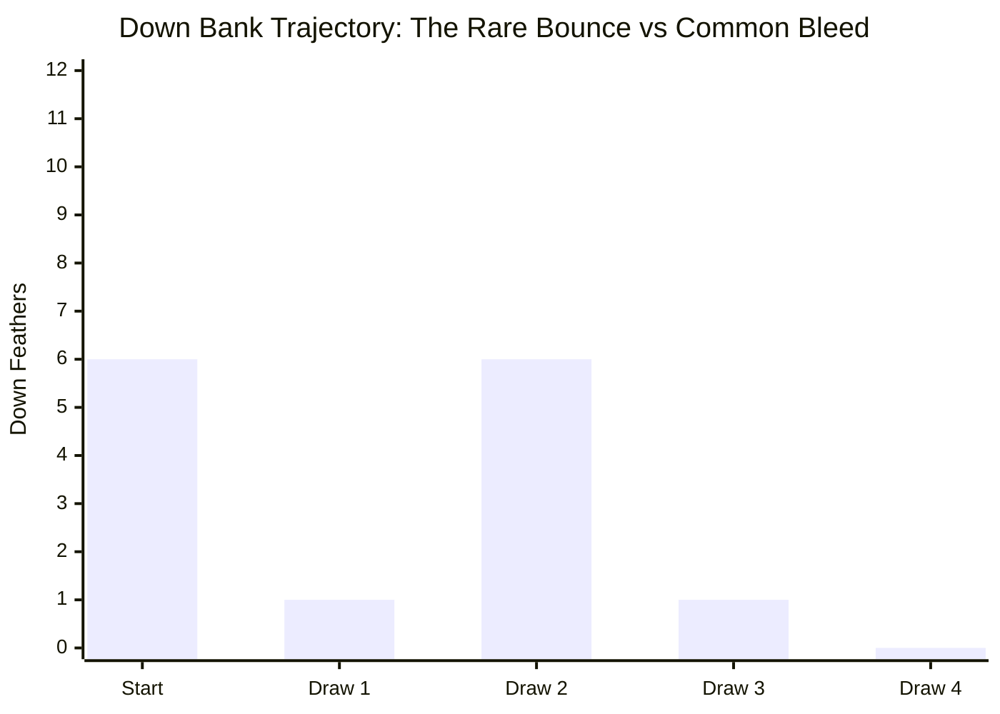
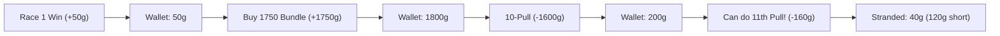

# Plan 17: Down Exchange and Whole-Wallet Validation — Bounded Mechanism Outline

**Date:** 2026-10-25  
**Status:** Mechanism Outline Submitted for Owner Gate (Pre-Scenario Implementation)  
**Packet:** [`docs/development/plan-17-down-exchange-and-wallet-validation.md`](file:///c:/AI/Quackpot/docs/development/plan-17-down-exchange-and-wallet-validation.md)  
**Scope:** Strictly bounded to `reports/development/plan-17-down-exchange-and-wallet-validation/`. Existing `sim/` and `src/` modules are read-only references.

---

## Executive Summary & Calibration Context

In the Plan 12 owner interview and subsequent orchestration decisions ([DECISION-008](file:///c:/AI/Quackpot/docs/decision-log.md#L97-L110) and [DECISION-009](file:///c:/AI/Quackpot/docs/decision-log.md#L111-L120)), the owner refined the Down economy:
1. **Target Calibration:** **3 Down** for a minor temporary speed item, and **6 Down** for a single-pull ticket. This supersedes the founding document's near-useless shop direction and the wireframe's 100-Down ticket mock.
2. **Pedagogical Objective:** The exchange must be usable enough for students to actively encounter and test after their initial pulls, while remaining strictly lossy in the long run. The experience should evoke the feeling of "almost catching up" through occasional recovery windfalls, without ever permitting an infinite or profitable pull loop.
3. **Odd-Bundle Grounding:** The 1,750-gem bundle leaving 150 gems (10 short of 160) is accepted as an isolated bundle arithmetic example; actual whole-wallet balances (accounting for race income and prior pack purchases) must be evaluated.

This outline presents the mathematical reconciliation of current probabilities, identifies unresolved mechanical rules for tickets and items, proves long-run subcritical decay, documents transient recovery trajectories, and recalculates whole-wallet progressions before running headless simulation scenarios.

---

## 1. Six-Identity Duplicate Payouts and Opening Distributions

### 1.1 Roster & Probability Structure
The active Banner 1 roster ([`src/core/game-engine.mjs`](file:///c:/AI/Quackpot/src/core/game-engine.mjs#L15-L22)) contains exactly 6 duck identities:
- **Common (3 identities, 80.0% total base odds):** `duck-0` (Puddle Quacker), `duck-1` (Rubber Mallard), `duck-3` (Bath Cadet).  
  *Per-identity probability:* $p_C = 0.80 / 3 \approx 0.266667$ (26.67%).
- **Rare (2 identities, 18.0% total base odds):** `duck-2` (Pond Rocket), `duck-4` (Turbo Drake).  
  *Per-identity probability:* $p_R = 0.18 / 2 = 0.090000$ (9.00%).
- **Legendary (1 identity, 2.0% total base odds):** `duck-5` (Biblically Accurate Duck).  
  *Per-identity probability:* $p_L = 0.020000$ (2.00%).

### 1.2 Duplicate Payout Constants
[`GAME_CONSTANTS.DOWN_PER_DUPLICATE`](file:///c:/AI/Quackpot/src/core/game-engine.mjs#L35):
- **Common Duplicate:** 1 Down
- **Rare Duplicate:** 5 Down
- **Legendary Duplicate:** 20 Down

### 1.3 Exact 10-Pull Opening Distribution (From Empty Roster)
By the Pigeonhole Principle, drawing 10 cards across 6 distinct identities guarantees at least $10 - 6 = 4$ duplicate cards. It is mathematically impossible to obtain fewer than 4 duplicate cards.

An exact multinomial state evaluation over all $6^{10} = 60,466,176$ draw outcomes yields:

#### Duplicate Cards Distribution (Independent of Tier)
| Duplicate Cards | Exact Probability | Cumulative |
| :---: | :---: | :---: |
| **0 to 3** | **0.0000%** | 0.0000% |
| **4** | **4.2833%** | 4.2833% |
| **5** | **34.1784%** | 38.4617% |
| **6** | **46.2870%** | 84.7487% |
| **7** | **14.6737%** | 99.4224% |
| **8** | **0.5770%** | 99.9995% |
| **9** | **0.0005%** | 100.0000% |

- **Mean duplicate cards:** $5.7308$
- **Median duplicate cards:** $6$

#### Down Feathers Gained Distribution (Weighted by Tier Payouts)
Because duplicate payouts are heavily weighted by tier (1 / 5 / 20), Down gained is highly dispersed:

| Down Feathers Gained | Exact Probability | Cumulative | Notes / Affordable Exchange |
| :---: | :---: | :---: | :--- |
| **4** | 2.0200% | 2.0200% | All 4 dups Common. 1 speed item (3 Down); 2 short of ticket. *(Plan 03 trial fixture)* |
| **5** | 16.0293% | 18.0493% | 5 dups Common, or 1 Rare dup. 1 speed item (3 Down); 1 short of ticket. |
| **6** | 26.8080% | 44.8573% | 6 Common, or 1 Rare + 1 Common. **1 ticket (6 Down) or 2 speed items**. |
| **7** | 12.2740% | 57.1313% | 7 Common, or 1 Rare + 2 Common. 1 ticket + 1 remainder. |
| **8** | 1.9885% | 59.1198% | 8 Common, or 1 Rare + 3 Common. 1 ticket + 2 remainder. |
| **9** | 11.6019% | 70.7217% | 1 Rare + 4 Common. 1 ticket + 3 remainder (or 3 speed items). |
| **10** | 13.1378% | 83.8595% | 2 Rare dups, or 1 Rare + 5 Common. 1 ticket + 4 remainder. |
| **11 – 13** | 6.4149% | 90.2744% | 1 to 2 tickets. |
| **14** | 4.4933% | 94.7677% | 2 Rare + 4 Common. **2 tickets (12 Down) + 2 remainder**. |
| **15 – 23** | 3.3275% | 98.0952% | Multiple tickets or mixed item baskets. |
| **24 – 29** | 1.8398% | 99.9350% | Includes Legendary dups (20 Down) + Rare/Common dups. **4 tickets**. |
| **30+** | 0.0650% | 100.0000% | High-windfall burst (e.g. 2+ Legendary/Rare duplicates). |

#### Critical Calibration Findings:
1. **$P(\text{Down} \ge 3) = 100.0000\%$:** Every single player drawing the initial free 10-pull from an empty roster is mathematically guaranteed to earn at least 4 Down. **100% of students can afford the 3-Down minor speed item.**
2. **$P(\text{Down} \ge 6) = 81.9507\%$:** Over 4 out of 5 students (~82%) earn enough Down on their first 10-pull to purchase at least one 6-Down single-pull ticket.
3. **$P(\text{Down} < 6) = 18.0493\%$:** Only ~18% of students are left with 4 or 5 Down, experiencing a shortfall of 1 or 2 Down to reach a ticket.
   - *Plan 03 Fixture Context:* The static mechanism trial fixture in Plan 03 produced exactly 4 duplicates (all Common = 4 Down). This represented the extreme low tail (2.02% probability). A live PRNG run will see the vast majority of players qualify for a ticket immediately.
4. **Ticket Affordability Distribution ($\lfloor \text{Down} / 6 \rfloor$):**
   - **0 tickets:** $18.0493\%$
   - **1 ticket:** $67.2492\%$
   - **2 tickets:** $11.2779\%$
   - **3 tickets:** $1.9093\%$
   - **4+ tickets:** $1.5143\%$
5. **Expected Mean Down:** $E[\text{Down}] = 8.3706$ Down (median $7$ Down).

### 1.4 Small-Roster vs. Future Large-Roster Distinction
- **Current 6-Identity Roster:** The extreme pigeonhole effect forces $\ge 4$ duplicates on turn 1, giving students immediate access to the Down exchange.
- **Future Expanded Roster (e.g., 20+ identities):** In a 20-duck roster, a 10-pull from an empty collection would have a high probability of 0 to 2 duplicates, meaning most players would start with 0 Down. The small roster serves the pedagogical goal of guaranteeing that the secondary-currency mechanism is encountered early.

### 1.5 Representative Opening Traces
To ensure simulation scenarios test real behaviors rather than convenient fixtures, four representative archetypes are identified:
1. **Low Tail / Fixture Trace (~2% frequency):** 4 Common duplicates $\to$ **4 Down**. (Affords 1 speed item; 2 Down short of ticket).
2. **Typical / Median Trace (~27% frequency):** 1 Rare duplicate + 1 Common duplicate (or 6 Common) $\to$ **6 Down**. (Affords exactly 1 ticket, 0 remainder).
3. **Upper-Middle Trace (~13% frequency):** 2 Rare duplicates $\to$ **10 Down**. (Affords 1 ticket with 4 Down remainder, or 3 speed items).
4. **Windfall Burst Trace (~1.5% frequency):** 1 Legendary duplicate + 1 Rare duplicate $\to$ **25 Down**. (Affords 4 tickets with 1 Down remainder).

---

## 2. Unresolved Ticket Rules Catalog & Decision Matrix

To model ticket recycling faithfully without making unauthorized assumptions, five unresolved mechanical rules must be decided by the owner:

### Rule T1: Do Ticket Draws Award Down on Duplicates?
- **Option A (Full Gacha Authenticity — Recommended for Modeling):** Ticket pulls are authentic draws; duplicates convert to 1, 5, or 20 Down normally.
  - *Consequences:* Allows occasional recycling bounces (e.g. Rare duplicate returns 5 Down, putting player 1 Down away from another ticket). Does *not* create an infinite loop (see Section 3).
  - *Receipt Impact:* Accurately reflects secondary-currency churn: "Spent 6 Down $\to$ gained 1/5 Down."
- **Option B (Damped / Single-Hop Terminal):** Ticket draws do not generate Down feathers (`downGained: 0`).
  - *Consequences:* Strictly limits recycling to exactly 1 hop. Completely eliminates cascading recovery trajectories.
  - *Pedagogical Risk:* Feels arbitrary and game-like to students if a duplicate card visibly fails to dissolve into feathers.

### Rule T2: Do Ticket Draws Advance Pity Toward Legendary?
- **Option A (Standard Carry):** Every ticket pull increments `pityCount` by 1.
  - *Consequences:* Increases the long-run value of Down tickets. If a player recycles 5 tickets, they advance 5 steps toward soft pity (35) and hard pity (50).
- **Option B (Promotional / Pity Frozen — Matches Plan 03 Welcome Pull):** Ticket pulls execute at current odds but set `advancesPity: false`.
  - *Consequences:* Decouples Down recycling from pity manipulation. Prevents players from using free ticket churn to bypass pity costs.

### Rule T3: Banner Scope, Carry-Over, and Redemption Timing
- **Option A (Instant Pull on Active Banner — Simplest):** The shop action is "Pull with Down (6 Down)". The draw executes immediately on the current banner; no ticket token is stored in the wallet.
- **Option B (Inventory Token):** The shop awards an item `single_pull_ticket` to inventory. The player chooses when to redeem it.
  - *Consequences:* Requires ticket inventory state, persistence, and rules for whether tickets expire when banners change.

### Rule T4: Receipt Accounting & Currency Separation
Under Hard Constraint #2 and founding O1 specifications, the Receipt must never obscure cash vs. synthetic currency:
- **Acquisition Cost:** Tickets are acquired for 6 Down. They must *never* be logged as gem spending (160 gems) or cash spending ($0.00).
- **Three-Register Clarity:**
  - *We Displayed:* Ticket cost (6 Down), banner odds.
  - *You Did:* Spent 6 Down on ticket; drew duck `duck-X` (Duplicate: +Y Down).
  - *Did This Affect You?:* Secondary currency obfuscation register notes net Down balance and whether recycling influenced continued play.

### Rule T5: Unused Bank & Stranded Breakage Accounting
- When a student uninstalls or reaches the terminal debrief with a residual bank (e.g., 2 Down or 5 Down):
  - The Receipt debrief highlights **stranded currency / breakage**: "You were left with 5 Down (1 Down short of a ticket), a deliberate microtransaction pattern designed to encourage another purchase."

---

## 3. Long-Run Lossiness and Transient Recovery Dynamics

### 3.1 Mathematical Proof of Long-Run Lossiness (Subcritical Branching Process)
Even under the most generous assumption (Rule T1 = Option A, where ticket pulls award full Down), the Down exchange is **strictly lossy and cannot self-fund**.

#### Expected Value Calculation (Fully Owned Roster, Base Odds):
For a player who owns all 6 ducks, every draw is guaranteed to be a duplicate:
$$\begin{aligned}
E[\text{Down per draw}] &= (0.80 \times 1) + (0.18 \times 5) + (0.02 \times 20) \\
&= 0.80 + 0.90 + 0.40 \\
&= \mathbf{2.10\text{ Down}}
\end{aligned}$$

#### The Recycling Multiplier:
Let the cost of a ticket be $C = 6\text{ Down}$.  
The expected child-tickets generated per parent-ticket is:
$$R = \frac{E[\text{Down}]}{C} = \frac{2.10}{6} = \mathbf{0.35}$$

Because $R = 0.35 < 1.0$, this system constitutes a **subcritical Galton-Watson branching process**.

#### Total Draws from an Initial Endowment of $T_0$ Tickets:
The expected total number of draws generated from an initial bank of $T_0$ tickets is:
$$E[T_{\text{total}}] = \frac{T_0}{1 - R} = \frac{T_0}{1 - 0.35} = \frac{T_0}{0.65} \approx \mathbf{1.5385 \times T_0}$$

- **1 Ticket (6 Down initial):** Yields on average **$1.54$ total draws** before complete extinction.
- **2 Tickets (12 Down initial):** Yields on average **$3.08$ total draws**.
- **4 Tickets (24 Down initial):** Yields on average **$6.15$ total draws**.

#### Extinction Probability:
Because the maximum possible single-draw payout is 20 Down (yielding at most $\lfloor 20/6 \rfloor = 3$ tickets), and $P(\text{Legendary}) = 0.02$, the probability of ultimate extinction for any finite starting bank is **$1.0$ (almost surely)**. An infinite loop is mathematically impossible.

### 3.2 Transient Recovery Trajectories ("Almost Catching Up")
While the macro-system decays rapidly at $-65\%$ per generation, individual micro-trajectories provide compelling psychological illusions of recovery:

1. **The "Rare Bounce" (18.0% probability per draw):**
   - Player buys a ticket for 6 Down (balance drops from 7 to 1 Down).
   - Ticket draws a Rare duplicate $\to$ **+5 Down**.
   - Balance rebounds to $1 + 5 = \mathbf{6\text{ Down}}$!
   - *Player Experience:* "The ticket paid for itself! I got a free roll!"
2. **The "Legendary Windfall" (2.0% probability per draw):**
   - Player spends last 6 Down on a ticket (balance 0).
   - Ticket hits Legendary duplicate $\to$ **+20 Down**.
   - Balance jumps to **20 Down**, immediately funding **3 more tickets** plus 2 Down remainder.
   - *Player Experience:* A sudden cascade of 4–6 consecutive draws that feels like an infinite break-even streak, before decaying to zero.
3. **The "Common Bleed" (80.0% probability per draw):**
   - Player spends 6 Down $\to$ draws Common duplicate $\to$ gets **+1 Down**.
   - Net loss: $-5$ Down. Recycling terminates immediately unless additional gems are spent.

---

## 4. 3-Down Item Calibration & Pond Race Impact

### 4.1 Deconstructing the Wireframe Strawman (+0.5% Speed)
The Plan 12 review wireframe included a placeholder item ("Soggy Breadcrumb") with sample text: *"+0.5% speed for 1 race at 15 Down"*.  
The owner directed:
- Re-price to **3 Down**.
- Do **not** adopt the +0.5% sample value by implication.
- Ensure the effect maps to actual race resolution and is observable without inventing winning guarantees.

### 4.2 Race Resolution Mechanics ([`src/core/game-engine.mjs`](file:///c:/AI/Quackpot/src/core/game-engine.mjs#L267-L295))
In the pond race:
- **Common Duck Base Speed:** $S = 10.0$.
- **Stance Performance:**
  - *Safe Pace:* $S \times [1 \pm 0.05] \implies [9.50, 10.50]$ (mean $10.00$, span $1.00$).
  - *Sprint Push:* $1.10 S \times [1 \pm 0.20] \implies [8.80, 13.20]$ (mean $11.00$, span $4.40$).
- **Finale Field Speed (Race 2):** Base speed $11.20 \times [1 \pm 0.05] \implies [10.64, 11.76]$.

#### Impact of +0.5% Speed:
A $+0.5\%$ boost on $S=10.0$ adds $+0.05$ speed ($S \to 10.05$).
- In Safe Pace, performance becomes $[9.5475, 10.5525]$.
- The $+0.05$ boost is **20 times smaller** than the $\pm 1.00$ noise window.
- In Race 2, max Common Safe performance ($10.55$) remains completely incapable of beating the slowest opponent ($10.64$). The player cannot observe this boost.

### 4.3 Proposed Item Options for Owner Review

| Option | Boost Specification | Stance Impact | Observability | P2W Risk / Guarantee |
| :--- | :--- | :--- | :--- | :--- |
| **Option I1 (Noticeable Margin Boost — Recommended)** | **+5.0% Speed** ($+0.5$ on Common) for 1 race. Non-stacking. | Safe: $[9.98, 11.03]$. Sprint: $[9.24, 13.86]$. | Shaves $\sim 0.2$s off race time in HUD; visibly shifts finish order on close calls. | **No guarantee:** Common Safe still averages $10.50$, losing to Race 2 field ($11.20$), but Sprint win odds improve from $\sim 35\%$ to $\sim 48\%$. |
| **Option I2 (Noise Dampener / Consistency)** | **Noise Halving** (Safe noise $\pm 2.5\%$, Sprint $\pm 10\%$) for 1 race. | Compresses variance without altering target speed. | Race finish is highly predictable; prevents disastrous bottom-roll blowouts. | Low; does not elevate duck past higher-tier opponents. |
| **Option I3 (Duration / Day Pass)** | **+3.0% Speed** lasting for the entire in-game Day (all races on that day). | Persistent mild buff across Tutorial and Finale. | Visible active buff banner on HUD throughout the day. | May discourage purchasing gacha ducks if perceived as a substitute. |

### 4.4 The 3-Down vs. 6-Down Pedagogical Trade-off
- **2 Speed Items (6 Down) = 1 Gacha Pull Ticket (6 Down).**
- This comparison teaches students how predatory secondary stores offer **ephemeral consumable sinks**:
  - The consumable item disappears after 30 seconds of racing and cannot overcome high-tier power creep.
  - The ticket grants a permanent duck collectible, advances pity (if Rule T2=A), and returns 1–20 Down back.
  - Students who buy breadcrumbs drain their Down bank and lose recycling potential.

---

## 5. Whole-Wallet Bundle Arithmetic vs. Odd-Bundle Traps

### 5.1 Isolated Bundle Arithmetic vs. Whole-Wallet Realities
The Plan 12 interview highlighted the **1,750-gem bundle** as a classic odd-bundle trap:
- Cost: $4.99 for 1,750 gems.
- 10-Pull Cost: 1,600 gems.
- **Isolated Remainder:** $1,750 - 1,600 = \mathbf{150\text{ gems}}$.
- **Isolated Shortfall:** $160 - 150 = \mathbf{10\text{ gems short}}$ of a single pull.

However, in a real playthrough, the student's wallet is never empty when purchasing this bundle.

### 5.2 Concrete Wallet Progression Scenarios

| Progression Path | Wallet Before Purchase | Bundle Added | Total Gems | After 10-Pull (1,600g) | Single Pulls Affordable | Stranded Remainder | True Shortfall to Next Pull |
| :--- | :---: | :---: | :---: | :---: | :---: | :---: | :---: |
| **Path 1: Pure Isolated Bundle** *(No prior play)* | 0g | 1,750g | 1,750g | 150g | 0 | 150g | **10g short** *(The isolated trap)* |
| **Path 2: Tutorial Race Winner** *(Standard Day 1)* | 50g | 1,750g | 1,800g | 200g | **1** | **40g** | **120g short** |
| **Path 3: Starter Pack Purchaser** *(After 1 single pull)* | 130g | 1,750g | 1,880g | 280g | **1** | **120g** | **40g short** |
| **Path 4: Starter Pack Alone** *($0.99 for 240g)* | 50g | 240g | 290g | N/A | **1** | **130g** | **30g short** |
| **Path 5: Two Race Wins** *(Day 1 + Day 2)* | 100g | 1,750g | 1,850g | 250g | **1** | **90g** | **70g short** |

### 5.3 Pedagogical & Receipt Implications
1. **The Shortfall Shift:** In actual play (Path 2), the 50 race gems convert the 150 remainder into **200 gems**, which **enables an immediate 11th pull**, leaving **40 gems stranded** (a 120-gem shortfall).
2. **Avoiding Receipt Contradictions:**
   - If the Receipt states: *"The 1,750 bundle left you 10 gems short of a pull,"* an observant student will protest: *"No it didn't, I had 200 gems and did another pull!"*
   - **Required Receipt Phrasing:** The Receipt must distinguish the **inherent bundle remainder** ($1,750 \pmod{1,600} = 150\text{ gems}$) from the **effective wallet remainder** ($G_{\text{wallet}} \pmod{160} = 40\text{ gems}$). Both illustrate predatory currency breakage, but without factual distortion.

---

## 6. Proposed Testing Matrix for Headless Scenario Scripts

Following owner selection on the unresolved rules above, the following headless simulation scenarios are proposed for execution within this folder (`reports/development/plan-17-down-exchange-and-wallet-validation/`):

1. **Scenario S1 (Opening Down Calibration & Percentiles):**
   - Run 100,000 independent seeds of the free 10-pull from empty roster.
   - Output empirical percentiles (p5, p25, p50, p75, p95) for duplicate cards, Down gained, and affordable tickets.
2. **Scenario S2 (Ticket Recycling Survival & Run-Length Distribution):**
   - Under selected Rules T1 & T2, test starting banks of 6, 12, 18, and 24 Down across 50,000 runs.
   - Measure: mean pulls generated, max cascade length, extinction rate, and frequency of "Rare bounces" and "Legendary windfalls".
3. **Scenario S3 (Pity-Window Burst Behavior):**
   - Test ticket recycling starting at pity count 0, 30, and 45.
   - Measure whether pity-induced Legendary bursts alter long-run subcriticality.
4. **Scenario S4 (Race Item Observable Impact):**
   - Simulate 10,000 pond races comparing baseline Common duck vs. Option I1 (+5% speed) across Safe and Sprint stances.
   - Measure win rate delta, average finish place, and time delta in seconds.
5. **Scenario S5 (Whole-Wallet Multi-Day Cash/Gem Traces):**
   - Trace full wallet balances across Paths 1–5, logging exact Receipt entries and stranded currency amounts.

---

## 7. Owner Decisions Required Before Scenario Execution

To proceed from this mechanism outline to executable scenario validation, the owner is requested to review and select:

1. **Rule T1:** Do ticket duplicate draws award Down feathers? *(Recommend Option A: Full conversion to preserve authentic gacha expectations and recovery bounces).*
2. **Rule T2:** Do ticket draws advance pity count? *(Recommend Option A or Option B; evaluate trade-off between pity-farming and consistency).*
3. **Rule T3:** Are tickets redeemed instantly on the active banner or stored as inventory? *(Recommend Option A: Instant redemption).*
4. **3-Down Item:** Approve Option I1 (+5.0% speed for 1 race, non-stacking) or provide alternative preference.
